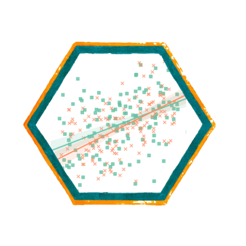
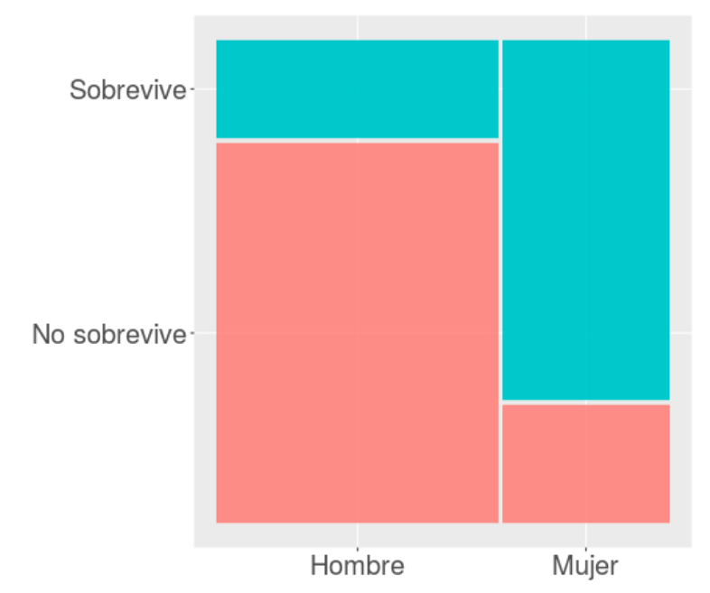

```{r}
#| label: setup
#| include: false
library(ggplot2)
library(knitr)
library(kableExtra)
library(sjPlot)
library(dplyr)
library(sjmisc)
library(summarytools)

azul <- "#04245f"
azul_claro <- "#4f97ff"
rojo <- "#c0392b"

theme_set(theme_minimal(base_size = 16))

# --- Titanic ---
load(url("https://github.com/Kevin-carrasco/metod3-unab/raw/refs/heads/main/practicos/data/titanic.Rdata"))

tt <- tt %>%
  mutate(survived_n = ifelse(survived == "Sobrevive", 1, 0))

# Modelo de probabilidad lineal con sexo
lpm_sexo <- lm(survived_n ~ sex, data = tt)

medias_sexo <- tt %>%
  group_by(sex) %>%
  summarise(promedio = mean(survived_n), n = n())

# Caso construido para ilustrar el problema del rango
tt_edad <- tt %>% filter(!is.na(age))
tt_edad$survived_n2 <- tt_edad$survived_n
tt_edad$survived_n2[tt_edad$age > 40] <- 0
tt_edad$survived_n2[tt_edad$age < 20] <- 1

lpm_edad <- lm(survived_n2 ~ age, data = tt_edad)
log_edad <- glm(survived_n2 ~ age, data = tt_edad, family = "binomial")

pred_lpm <- fitted.values(lpm_edad)
fuera <- sum(pred_lpm < 0 | pred_lpm > 1)

# Odds y odds ratio
tabla_tt <- table(tt$survived, tt$sex)
odds_h <- tabla_tt["Sobrevive", "Hombre"] / tabla_tt["No sobrevive", "Hombre"]
odds_m <- tabla_tt["Sobrevive", "Mujer"] / tabla_tt["No sobrevive", "Mujer"]
or_tt <- odds_m / odds_h
odds_total <- sum(tt$survived == "Sobrevive") / sum(tt$survived == "No sobrevive")

# Tabla probabilidades, odds y logit
tabla_logit <- data.frame(prob = c(0.001, 0.05, 0.1, 0.2, 0.3, 0.4, 0.5,
                                   0.6, 0.7, 0.8, 0.9, 0.95, 0.999)) %>%
  mutate(odds = prob / (1 - prob),
         logit = log(odds))

# Regresión logística con el Titanic
modelo_titanic <- glm(survived ~ sex, data = tt, family = "binomial")
b0_tt <- coef(modelo_titanic)[1]
b1_tt <- coef(modelo_titanic)[2]

modelo_titanic_age <- glm(survived ~ age, data = tt, family = "binomial")
b_age <- coef(modelo_titanic_age)["age"]
p_age <- summary(modelo_titanic_age)$coefficients["age", 4]

# --- Segundo ejemplo: participación electoral (ELSOC 2016) ---
load(url("https://github.com/Kevin-carrasco/metod3-unab/raw/refs/heads/main/files/data/elsoc16-22.RData"))

elsoc <- elsoc_long_2016_2022.2 %>%
  filter(ola == 1) %>%
  select(c11, m01, m0_sexo, m0_edad) %>%
  set_na(., na = c(-999, -888, -777, -666)) %>%
  rename("participacion" = c11,
         "educacion" = m01,
         "sexo" = m0_sexo,
         "edad" = m0_edad) %>%
  na.omit() %>%
  filter(participacion < 3) %>%          # excluye "no tenía edad para votar"
  mutate(voto = ifelse(participacion == 1, 1, 0),
         voto_f = factor(voto, levels = c(0, 1),
                         labels = c("No votó", "Votó")),
         sexo_f = factor(sexo, levels = c(1, 2),
                         labels = c("Hombre", "Mujer")),
         tramo = cut(edad,
                     breaks = c(17, 29, 39, 49, 59, 100),
                     labels = c("18-29", "30-39", "40-49", "50-59", "60+")),
         educ_cat = case_when(educacion <= 3 ~ 1,
                              educacion <= 5 ~ 2,
                              TRUE ~ 3),
         educ_f = factor(educ_cat, levels = 1:3,
                         labels = c("Básica", "Media", "Superior")))

n_elsoc <- nrow(elsoc)
odds_voto <- sum(elsoc$voto) / sum(1 - elsoc$voto)

ct_sexo <- table(elsoc$sexo_f, elsoc$voto_f)
odds_vh <- ct_sexo["Hombre", "Votó"] / ct_sexo["Hombre", "No votó"]
odds_vm <- ct_sexo["Mujer", "Votó"] / ct_sexo["Mujer", "No votó"]
or_sexo <- odds_vm / odds_vh

tabla_odds <- function(variable) {
  elsoc %>%
    group_by({{ variable }}) %>%
    summarise(no_voto = sum(voto == 0),
              voto = sum(voto == 1)) %>%
    mutate(pct = round(voto / (voto + no_voto) * 100, 1),
           odds = round(voto / no_voto, 3),
           OR = round(odds / first(odds), 2))
}

tabla_edad <- tabla_odds(tramo)
tabla_educ <- tabla_odds(educ_f)

edad_educ <- elsoc %>%
  group_by(educ_f) %>%
  summarise(edad_promedio = round(mean(edad), 1))

m_sexo <- glm(voto ~ sexo_f, data = elsoc, family = "binomial")
m_edad <- glm(voto ~ edad, data = elsoc, family = "binomial")
or_edad <- exp(coef(m_edad)["edad"])
```

##  {data-background-color="black"}

::: {.columns .v-center-container}
::: {.column width="20%"}
{width="100%" fig-align="center"}
:::

::: {.column width="80%"}
### Métodos estadísticos para
### Ciencias Sociales III

------------------------------------------------------------------------

### **Kevin Carrasco**
### Sociología - UNAB
### 2do Sem 2026
### [https://metod3-unab.netlify.app/](https://metod3-unab.netlify.app/)
:::
:::

# Sesión 8 {data-background-color="black"}

Regresión logística: odds, odds ratio y coeficientes logit

## ¿Dónde quedamos?

::: {.incremental}

- En la sesión de variables dummy incorporamos variables **categóricas** al modelo de regresión

- Vimos que sus números son etiquetas, que se codifican como **dummy**, y que su coeficiente es una diferencia de promedios respecto de una categoría de referencia

- Pero esas variables categóricas estaban siempre del lado **independiente** de la ecuación

- En el último taller tuvimos un primer acercamiento a las dependientes **dicotómicas**

:::

##  {data-background-color="black"}

### Regresión logística

### Para variables dependientes **dicotómicas**

## Hoy

::: {.incremental}

1. ¿Por qué el modelo de regresión que conocemos **no sirve** cuando la dependiente es dicotómica?

2. ¿Qué alternativa existe?

3. Probabilidades, **odds** y **odds ratio**

4. El **logit** y la estimación de la regresión logística

5. Interpretación de **coeficientes**

6. Un ejemplo sociológico: la **participación electoral**

:::

# Tipos de variables {data-background-color="black"}

## Variables

::: {.incremental}

- **Discretas** (rango finito de valores):

    - Dicotómicas
    - Politómicas

- **Continuas**:

    - Rango (teóricamente) infinito de valores

:::

## Niveles de medición de variables

- NOIR: Nominal, Ordinal, Intervalar, Razón

::: {.small}

| Tipo | Características | Propiedad de números | Ejemplo |
|------|-----------------|----------------------|---------|
| *Nominal* | Uso de números en lugar de palabras | Identidad | Nacionalidad |
| *Ordinal* | Números se usan para ordenar series | + ranking | Nivel educacional |
| *Intervalar* | Intervalos iguales entre números | + igualdad | Temperatura |
| *Razón* | Cero real | + aditividad | Distancia |

:::

## Tipos de datos en relación a escalas de medición

::: {.incremental}

- **Datos categóricos**: pueden ser medidos solo mediante escalas nominales, u ordinales en caso de orden de rango

- **Datos continuos**:

    - Medidos en escalas intervalares o de razón
    - Pueden ser transformados a datos categóricos

:::

## Descriptivos según tipo de variable

::: {.small}

| | Categórica | Continua | Categ.(y)/Categ.(x) | Cont.(y)/Categ.(x) |
|---|---|---|---|---|
| **Ejemplo** | **Estatus ocupacional** | **Ingreso** | **Estatus ocupacional (Y) / Sexo (X)** | **Ingreso (Y) / Sexo (X)** |
| Tabla | Frecuencias / porcentajes | $\bar{X}$ / sd | Tabla de contingencia | Clasificar Y |
| Gráfico | Barras | Histograma / boxplot | Barras condicionado | Histograma o boxplot condicionado |

:::

## Análisis estadístico según tipos de variables

- Variable dependiente (y): lo que quiero explicar

- Variable independiente (x): lo que me permite explicar la dependiente

::: {.small}

| Variable independiente (x) | Variable dependiente **categórica** | Variable dependiente **continua** |
|---|---|---|
| Categórica | Tabla de contingencia, Chi<sup>2</sup> | ANOVA, prueba t |
| Continua | **Regresión logística** | Correlación / regresión lineal |

:::

::: {.fragment .fade-up}

Todo el curso ha transcurrido en la **columna derecha**. Hoy nos movemos a la izquierda

:::

# El caso del Titanic {data-background-color="black"}

##  {data-background-color="black"}

::: {.columns .v-center-container}
::: {.column width="45%"}
{width="85%"}
:::

::: {.column width="55%"}
### ¿Se puede anticipar el final?
:::
:::

## Titanic data

```{r}
#| label: desc-tt
#| echo: false
#| results: asis

tt2 <- tt %>% select(survived, sex, age)

print(dfSummary(tt2, headings = FALSE, valid.col = FALSE,
                graph.magnif = 0.7), method = "render")
```

## Sobrevivientes

```{r}
#| label: fig-sobrevivientes
#| echo: false
#| fig-width: 8
#| fig-height: 4.2

ggplot(tt, aes(survived, fill = survived)) +
  geom_bar() +
  geom_text(aes(label = scales::percent(after_stat(count) / sum(after_stat(count)))),
            stat = "count", size = 7, vjust = 2, color = "white") +
  scale_fill_manual(values = c(azul, azul_claro)) +
  theme(legend.position = "none",
        axis.title = element_blank())
```

## Sexo

```{r}
#| label: fig-sexo
#| echo: false
#| fig-width: 8
#| fig-height: 4.2

ggplot(tt, aes(sex, fill = sex)) +
  geom_bar() +
  geom_text(aes(label = scales::percent(after_stat(count) / sum(after_stat(count)))),
            stat = "count", size = 7, vjust = 2, color = "white") +
  scale_fill_manual(values = c(azul, azul_claro)) +
  theme(legend.position = "none",
        axis.title = element_blank())
```

## Sobrevivencia / sexo

::: {.columns}
::: {.column width="50%"}

{width="95%"}

:::
::: {.column width="50%"}

```{r}
#| label: prop-sexo
#| echo: false

kable(round(prop.table(table(tt$survived, tt$sex), 2), 2))
```

El 75% de las mujeres sobrevive, mientras el 25% no sobrevive

:::
:::

##  {data-background-color="black"}

### ¿En qué medida la probabilidad de sobrevivir depende del sexo?

### ¿Es esta probabilidad estadísticamente significativa?

## Alternativas

::: {.incremental}

- **Tabla de contingencia**, $\chi^2$:

    - análisis de tendencia general, significación estadística
    - pero es poco parsimoniosa, y no hay control estadístico

- **¿Aprovechar las ventajas del modelo de regresión?**

    - expresar la relación en un número ($\beta$)
    - inferencia
    - control estadístico

:::

# El modelo de probabilidad lineal {data-background-color="black"}

## Modelando la probabilidad de sobrevivir con OLS

```{r}
#| label: lpm-intento
#| echo: true
#| eval: false

reg_tit <- lm(survived ~ sex, data = tt)
```

::: {.fragment .fade-up}

La variable dependiente está guardada como **factor**, de modo que primero debemos recodificarla como 0 y 1:

```{r}
#| label: recode-surv
#| echo: true
#| eval: false

tt <- tt %>%
  mutate(survived_n = ifelse(survived == "Sobrevive", 1, 0))

reg_tit <- lm(survived_n ~ sex, data = tt)
```

:::

## Modelo de probabilidad lineal

::: {.columns}
::: {.column width="48%"}

::: {.small}

Se da este nombre a los modelos de regresión donde una variable dependiente dicotómica se estima de manera tradicional, es decir, por mínimos cuadrados ordinarios

:::

:::
::: {.column width="52%"}

```{r}
#| label: tab-lpm
#| echo: false
#| results: asis

tab_model(lpm_sexo,
          show.se = TRUE,
          show.ci = FALSE,
          digits = 3,
          p.style = "stars",
          dv.labels = c("Modelo 1"),
          pred.labels = c("(Intercepto)", "Sexo (Mujer)"),
          string.pred = "Predictores",
          string.est = "β")
```

:::
:::

## Significado de los coeficientes

::: {.columns}
::: {.column width="45%"}

**Promedio de supervivencia por sexo**

```{r}
#| label: medias-sexo
#| echo: false

kable(medias_sexo, digits = 3,
      col.names = c("Sexo", "Promedio", "N"))
```

:::
::: {.column width="55%"}

::: {.incremental}

- El valor del intercepto, `r round(coef(lpm_sexo)[1], 3)`, es el valor predicho para la categoría de referencia, "hombre"

- El $\beta$ de sexo (mujer), `r round(coef(lpm_sexo)[2], 3)`, sumado al intercepto, equivale a la proporción de supervivencia de las mujeres

:::

:::
:::

##  {data-background-color="black"}

### Funciona ...

::: {.fragment .fade-up}

### **PERO**

:::

## Limitaciones del modelo lineal para dependientes dicotómicas

```{r}
#| label: fig-lpm-sexo
#| echo: false
#| fig-width: 8
#| fig-height: 4

ggplot(tt, aes(x = as.numeric(sex), y = survived_n)) +
  geom_point(aes(color = as.factor(survived_n)), shape = 1, alpha = 0.5) +
  geom_smooth(method = "lm", color = "gray20", se = FALSE) +
  scale_color_manual(values = c(azul, azul_claro)) +
  labs(title = "Regresión lineal por mínimos cuadrados",
       x = "Sexo", y = "Sobrevive") +
  theme(legend.position = "none")
```

## Problemas ...

```{r}
#| label: fig-lpm-edad
#| echo: false
#| fig-width: 9
#| fig-height: 4.2

ggplot(tt_edad, aes(x = age, y = survived_n)) +
  geom_point(aes(color = as.factor(survived_n)), shape = 1, alpha = 0.5) +
  geom_smooth(method = "lm", color = "gray20", se = FALSE) +
  scale_color_manual(values = c(azul, azul_claro)) +
  labs(title = "Regresión lineal por mínimos cuadrados",
       x = "Edad", y = "Sobrevive") +
  theme(legend.position = "none")
```

## Problemas ...

::: {.columns}
::: {.column width="40%"}

Si hubieran sobrevivido todos los menores de 20 y muerto todos los mayores de 40 ...

```{r}
#| label: construida
#| echo: true
#| eval: false

tt$survived_n2 <- tt$survived_n
tt$survived_n2[tt$age > 40] <- 0
tt$survived_n2[tt$age < 20] <- 1
```

:::
::: {.column width="60%"}

```{r}
#| label: fig-lpm-construida
#| echo: false
#| fig-width: 6
#| fig-height: 4.5

ggplot(tt_edad, aes(x = age, y = survived_n2)) +
  geom_point(aes(color = as.factor(survived_n2)), shape = 1, alpha = 0.5) +
  geom_smooth(method = "lm", color = "gray20", se = FALSE) +
  geom_hline(yintercept = c(0, 1), color = rojo, linetype = "dashed") +
  scale_color_manual(values = c(azul, azul_claro)) +
  labs(title = "Mínimos cuadrados",
       x = "Edad", y = "Sobrevive") +
  theme(legend.position = "none")
```

:::
:::

## Predicciones imposibles

```{r}
#| label: resumen-lpm
#| echo: true

summary(fitted.values(lpm_edad))
```

::: {.fragment .fade-up}

```{r}
#| label: fuera-rango
#| echo: true

predichos <- fitted.values(lpm_edad)

sum(predichos < 0 | predichos > 1)
```

**`r fuera` casos** reciben una probabilidad predicha negativa o superior a 1

:::

##  {data-background-color="black"}

### Problemas de la regresión tradicional (OLS) para dependientes dicotómicas

::: {.incremental}

- ### Eventuales predicciones fuera del rango de probabilidades posibles

- ### Ajuste a los datos y residuos: ¿es la mejor aproximación una recta?

:::

# La solución {data-background-color="black"}

##  {data-background-color="black"}

### La regresión **logística** ofrece una solución a los problemas del rango de predicciones y de ajuste a los datos del modelo de probabilidad lineal

::: {.fragment .fade-up}

### Se logra mediante una *transformación* de los coeficientes a **LOGIT**

:::

##  {data-background-color="black"}

{width="80%" fig-align="center"}

## OLS vs Logit

::: {.columns}
::: {.column width="50%"}

```{r}
#| label: fig-ols
#| echo: false
#| fig-width: 5.5
#| fig-height: 4.5

ggplot(tt_edad, aes(x = age, y = survived_n2)) +
  geom_point(aes(color = as.factor(survived_n2)), shape = 1, alpha = 0.5) +
  geom_smooth(method = "lm", color = "gray20", se = FALSE) +
  geom_hline(yintercept = c(0, 1), color = rojo, linetype = "dashed") +
  scale_color_manual(values = c(azul, azul_claro)) +
  labs(title = "Regresión lineal", x = "Edad", y = "Sobrevive") +
  theme(legend.position = "none")
```

:::
::: {.column width="50%"}

```{r}
#| label: fig-logit
#| echo: false
#| fig-width: 5.5
#| fig-height: 4.5

ggplot(tt_edad, aes(x = age, y = survived_n2)) +
  geom_point(aes(color = as.factor(survived_n2)), shape = 1, alpha = 0.5) +
  stat_function(fun = function(x) {
    predict(log_edad, newdata = data.frame(age = x), type = "response")
  }, color = "gray20", linewidth = 1.1) +
  geom_hline(yintercept = c(0, 1), color = rojo, linetype = "dashed") +
  scale_color_manual(values = c(azul, azul_claro)) +
  labs(title = "Regresión logística",
       x = "Edad", y = "Probabilidad de sobrevivir") +
  theme(legend.position = "none")
```

:::
:::

## ¿Qué es el logit?

::: {.incremental}

### Es el logaritmo de los odds

### ... ¿y qué son los odds?

### Una razón de *probabilidades*

:::

::: {.fragment .fade-up}

### Para llegar hasta la regresión logística hay que pasar por los **odds** (chances) y los **odds ratio** (razón de chances)

:::

# Odds y odds ratio {data-background-color="black"}

## Odds

- **Odds** (chances): probabilidad de que algo ocurra dividido por la probabilidad de que no ocurra

$$Odds=\frac{p}{1-p}$$

::: {.fragment .fade-up}

Ejemplo del Titanic: 427 sobrevivientes (41%) y 619 muertos (59%)

$$Odds_{sobrevivir}=427/619=0.41/0.59=`r round(odds_total, 2)`$$

**Es decir, las chances de sobrevivir son de `r round(odds_total, 2)`**

:::

## Odds

::: {.incremental}

- Odds de 1 significan chances iguales, menores a 1 son negativas y mayores a 1 son positivas

- *Propiedad simétrica*:

    - un $Odds=4$ es una asociación positiva proporcional a la asociación negativa $Odds=1/4=0.25$

:::

## Odds de sobrevivencia para los hombres

::: {.columns}
::: {.column width="50%"}

```{r}
#| label: tabla-hombres
#| echo: false

kable(table(tt$survived, tt$sex))
```

```{r}
#| label: prop-hombres
#| echo: false

kable(round(prop.table(table(tt$survived, tt$sex), 2), 2))
```

::: {.small}
El 21% de los hombres sobrevive mientras el 79% no sobrevive
:::

:::
::: {.column width="50%"}

::: {.fragment .fade-up}

$$Odds_{hombres}=\frac{0.21}{0.79}=`r round(odds_h, 2)`$$

::: {.small}

*La probabilidad de sobrevivencia en los hombres es `r round(odds_h, 2)` veces la de no sobrevivencia*

... o en otros términos

*Hay `r round(odds_h, 2)` hombres que sobreviven por cada uno que no sobrevive*

*Hay 26 hombres que sobreviven por cada 100 hombres que no sobreviven*

:::

:::

:::
:::

## Odds de sobrevivencia para las mujeres

::: {.columns}
::: {.column width="50%"}

```{r}
#| label: prop-mujeres
#| echo: false

kable(round(prop.table(table(tt$survived, tt$sex), 2), 2))
```

::: {.small}
El 75% de las mujeres sobrevive, mientras el 25% no sobrevive
:::

:::
::: {.column width="50%"}

::: {.fragment .fade-up}

$$Odds_{mujeres}=\frac{0.75}{0.25}=3$$

::: {.small}

*La probabilidad de sobrevivencia en las mujeres es 3 veces la de no sobrevivencia*

*Hay 3 mujeres que sobreviven por cada mujer que no sobrevive*

o en otros términos

*Hay 300 mujeres que sobreviven al Titanic por cada 100 mujeres que no sobreviven*

:::

:::

:::
:::

## Odds ratio (OR)

::: {.columns}
::: {.column width="45%"}

Los odds ratio, o razón de chances, permiten reflejar la **asociación** entre las chances de dos variables dicotómicas

**¿Tienen las mujeres más chances de sobrevivir que los hombres?**

:::
::: {.column width="55%"}

::: {.fragment .fade-up}

```{r}
#| label: tab-xtab
#| echo: false
#| results: asis

tab_xtab(var.row = tt$survived,
         var.col = tt$sex,
         show.col.prc = TRUE,
         show.summary = FALSE)
```

:::

:::
:::

## Odds ratio

**¿Cuántas más chances de sobrevivir tienen las mujeres respecto de los hombres?**

- Odds supervivencia mujeres / odds supervivencia hombres

$$OR=\frac{p_{m}/(1-p_{m})}{p_{h}/(1-p_{h})}=\frac{0.753/(1-0.753)}{0.205/(1-0.205)}=\frac{`r round(odds_m, 3)`}{`r round(odds_h, 3)`}=`r round(or_tt, 2)`$$

::: {.fragment .fade-up}

### Las chances de sobrevivir de las mujeres son **`r round(or_tt, 2)`** veces más que las de los hombres

:::

## Cómo leer un odds ratio

::: {.small}

| Valor del OR | Significado | Ejemplo |
|---|---|---|
| OR = 1 | Sin asociación: ambos grupos tienen las mismas chances | |
| OR > 1 | El grupo comparado tiene **más** chances que el de referencia | Mujeres vs hombres en el Titanic: `r round(or_tt, 2)` |
| 0 < OR < 1 | El grupo comparado tiene **menos** chances que el de referencia | Hombres vs mujeres: 1 / `r round(or_tt, 2)` = `r round(1 / or_tt, 3)` |

:::

::: {.fragment .fade-up}

El OR depende de **qué grupo** se pone en el denominador. Por eso siempre hay que indicar cuál es la categoría de referencia

:::

##  {data-background-color="black"}

### El odds ratio nos permite expresar **en un número** la relación entre dos variables categóricas

### Por lo tanto, es una versión del $\beta$ para dependientes categóricas

##  {data-background-color="black"}

### Pero ... el **OR** por sí solo no permite inferencia ni control estadístico

### Para eso necesitamos una transformación adicional: el **logit**

# El logit {data-background-color="black"}

## Regresión logística y odds

::: {.columns}
::: {.column width="50%"}

```{r}
#| label: fig-logit2
#| echo: false
#| fig-width: 5.5
#| fig-height: 4.5

ggplot(tt_edad, aes(x = age, y = survived_n2)) +
  geom_point(aes(color = as.factor(survived_n2)), shape = 1, alpha = 0.5) +
  stat_function(fun = function(x) {
    predict(log_edad, newdata = data.frame(age = x), type = "response")
  }, color = "gray20", linewidth = 1.1) +
  scale_color_manual(values = c(azul, azul_claro)) +
  labs(title = "Regresión logística",
       x = "Edad", y = "Probabilidad de sobrevivir") +
  theme(legend.position = "none")
```

:::
::: {.column width="50%"}

Una de las transformaciones que permite realizar una estimación de regresión con variables dependientes dicotómicas es el **logit**, que es el logaritmo de los odds

:::
:::

## Logit

$$Logit=ln(Odds)=ln\left(\frac{p}{1-p}\right)$$

::: {.incremental}

- Es la variable dependiente que **efectivamente** estima la regresión logística

- La probabilidad está acotada entre 0 y 1; los odds, entre 0 e infinito

- El logit, en cambio, puede tomar **cualquier valor**, positivo o negativo, igual que la dependiente de una regresión lineal

:::

## Probabilidades, odds y logit

::: {.columns}
::: {.column width="45%"}

Partamos de un conjunto de probabilidades entre 0 y 1

```{r}
#| label: logit-tabla-code
#| echo: true
#| eval: false

tabla <- data.frame(
  prob = c(0.001, 0.05, 0.1, 0.2,
           0.3, 0.4, 0.5, 0.6,
           0.7, 0.8, 0.9, 0.95,
           0.999))
```

:::
::: {.column width="55%"}

```{r}
#| label: tabla-prob
#| echo: false

kable(tabla_logit %>% mutate(odds = "", logit = ""), digits = 3,
      col.names = c("Probabilidad", "Odds", "Logit")) %>%
  kable_styling(font_size = 20)
```

:::
:::

## Probabilidades, odds y logit

::: {.columns}
::: {.column width="45%"}

```{r}
#| label: logit-code
#| echo: true
#| eval: false

tabla$odds <- tabla$prob /
  (1 - tabla$prob)

tabla$logit <- log(tabla$odds)
```

::: {.small}

::: {.incremental}

- Probabilidad 0.5 = odds 1 = logit **0**

- Probabilidades bajo 0.5 = logits **negativos**

- Probabilidades sobre 0.5 = logits **positivos**

:::

:::

:::
::: {.column width="55%"}

```{r}
#| label: tabla-logit
#| echo: false

kable(tabla_logit, digits = 3,
      col.names = c("Probabilidad", "Odds", "Logit")) %>%
  kable_styling(font_size = 20) %>%
  row_spec(7, bold = TRUE, background = "#dbe8ff")
```

:::
:::

## Probabilidades, odds y logit

::: {.columns}
::: {.column width="45%"}

::: {.small}

::: {.incremental}

- Los odds son **asimétricos**: van de 0 a 1 para las probabilidades bajo 0.5, y de 1 a infinito para las que están sobre 0.5

- El logit es **simétrico**: 0.2 y 0.8 tienen logits de igual magnitud y signo opuesto

- En los extremos, pequeños cambios en la probabilidad implican grandes cambios en el logit

:::

:::

:::
::: {.column width="55%"}

```{r}
#| label: tabla-logit-extremos
#| echo: false

kable(tabla_logit, digits = 3,
      col.names = c("Probabilidad", "Odds", "Logit")) %>%
  kable_styling(font_size = 20) %>%
  row_spec(7, bold = TRUE, background = "#dbe8ff") %>%
  row_spec(c(4, 10), bold = TRUE, color = azul) %>%
  row_spec(c(1, 13), bold = TRUE, color = rojo)
```

:::
:::

## La curva logística

```{r}
#| label: fig-curva-logistica
#| echo: false
#| fig-width: 9
#| fig-height: 4.3

ggplot(data.frame(logit = c(-6, 6)), aes(x = logit)) +
  stat_function(fun = plogis, color = azul, linewidth = 1.3) +
  geom_hline(yintercept = c(0, 1), color = rojo, linetype = "dashed") +
  geom_vline(xintercept = 0, color = "gray60") +
  geom_hline(yintercept = 0.5, color = "gray60") +
  scale_y_continuous(breaks = seq(0, 1, 0.25)) +
  labs(x = "Logit", y = "Probabilidad")
```

::: {.small}
El modelo estima una **recta** en la escala del logit, que se transforma en una **curva** en la escala de la probabilidad. Por mucho que crezca o disminuya el logit, la probabilidad nunca sale del rango 0 a 1
:::

# Estimación {data-background-color="black"}

## Estimación en R: `glm`

```{r}
#| label: glm-sintaxis
#| echo: true
#| eval: false

modelo <- glm(dependiente ~ indep1 + indep2 + ...,
              data = datos,
              family = "binomial")
```

::: {.incremental}

- `glm` (*generalized linear model*) es la función para variables dependientes categóricas

- `family = "binomial"` indica que la dependiente es **dicotómica**

- La dependiente puede ser una variable 0 y 1, o un factor de dos categorías. En este último caso, R modela la probabilidad de la **segunda** categoría

:::

## Ejemplo Titanic

::: {.columns}
::: {.column width="45%"}

```{r}
#| label: glm-titanic-code
#| echo: true
#| eval: false

modelo_titanic <- glm(survived ~ sex,
                      data = tt,
                      family = "binomial")

tab_model(modelo_titanic,
          transform = NULL)
```

::: {.small}

::: {.incremental}

- `survived` tiene las categorías "No sobrevive" y "Sobrevive": se modela la probabilidad de **sobrevivir**

- `transform = NULL` le indica a `tab_model` que muestre los coeficientes **logit**, tal como salen del modelo

:::

:::

:::
::: {.column width="55%"}

```{r}
#| label: tab-titanic-logit
#| echo: false
#| results: asis

tab_model(modelo_titanic,
          transform = NULL,
          show.se = TRUE,
          show.ci = FALSE,
          show.r2 = FALSE,
          digits = 3,
          p.style = "stars",
          dv.labels = c("Sobrevivencia"),
          pred.labels = c("(Intercepto)", "Sexo (Mujer)"),
          string.pred = "Predictores",
          string.est = "Logit")
```

:::
:::

## La ecuación

Igual que en regresión lineal, el modelo puede escribirse como una ecuación, solo que ahora la dependiente es el logit:

$$ln\left(\frac{p}{1-p}\right)=\beta_0+\beta_1X_1$$

::: {.fragment .fade-up}

$$ln\left(\frac{p_{sobrevivir}}{1-p_{sobrevivir}}\right)=`r round(b0_tt, 3)`+`r round(b1_tt, 3)` \times Mujer$$

:::

::: {.fragment .fade-up}

::: {.small}
Mujer es una dummy: vale 1 para las mujeres y 0 para los hombres
:::

:::

## Interpretación de asociaciones y contraste de hipótesis

::: {.incremental}

- Coeficiente logit asociado a sexo (mujer) = **`r round(b1_tt, 3)`**

    - El log-odds de sobrevivencia aumenta para las mujeres en `r round(b1_tt, 3)` en comparación con los hombres

- **Contraste de hipótesis**

    - La diferencia en las chances de sobrevivir entre hombres y mujeres es estadísticamente significativa, por lo que se rechaza la hipótesis nula (de ausencia de diferencias entre hombres y mujeres) con un nivel de probabilidad $p<0.001$

:::

## Interpretación de coeficientes logit

::: {.incremental}

- **El signo** se lee directamente: un coeficiente positivo indica que aumentan las chances de que ocurra el evento; uno negativo, que disminuyen

- **La significación** se lee igual que en regresión lineal

- **La magnitud**, sustantivamente, no nos dice mucho, ya que el logit es una transformación de la escala original

:::

::: {.fragment .fade-up}

Para poder interpretar la magnitud del coeficiente se requiere volver a la métrica de odds mediante una transformación inversa o **exponenciación**

:::

## De logits a odds

::: {.columns}
::: {.column width="50%"}

$$logit=ln(Odds)$$

$$e^{logit}=Odds$$

$$e^{`r round(b1_tt, 3)`}=`r round(exp(b1_tt), 2)`$$

:::
::: {.column width="50%"}

```{r}
#| label: exp-coef
#| echo: true

exp(2.467)
```

```{r}
#| label: exp-coef-modelo
#| echo: true

exp(coef(modelo_titanic))
```

:::
:::

::: {.fragment .fade-up}

### Las chances (odds) de sobrevivir siendo mujer son **`r round(exp(b1_tt), 2)`** veces las de un hombre

:::

##  {data-background-color="black"}

### `r round(exp(b1_tt), 2)` ... ¿les suena?

::: {.fragment .fade-up}

### Es exactamente el **odds ratio** que calculamos a mano desde la tabla de contingencia

:::

::: {.fragment .fade-up}

### El coeficiente exponenciado de la regresión logística **es** un odds ratio

:::

## ¿Y el intercepto?

::: {.incremental}

- El intercepto logit es `r round(b0_tt, 3)`: el logit de sobrevivir para la categoría de referencia (hombres)

- Exponenciado: $e^{`r round(b0_tt, 3)`}=`r round(exp(b0_tt), 3)`$

- Es el **odds de sobrevivir de los hombres**, el mismo que calculamos en la tabla

:::

::: {.fragment .fade-up}

::: {.small}
Igual que en la regresión lineal con dummies, donde el intercepto era el promedio de la categoría de referencia
:::

:::

## De logits a odds: la ecuación

$$Odds=e^{\beta_0 + \beta_1X_1}$$

::: {.fragment .fade-up}

- Predicción para **mujeres** = `r round(b0_tt, 3)` + (`r round(b1_tt, 3)` × 1) = `r round(b0_tt + b1_tt, 3)`

- Predicción para **hombres** = `r round(b0_tt, 3)` + (`r round(b1_tt, 3)` × 0) = `r round(b0_tt, 3)`

:::

::: {.fragment .fade-up}

$$Odds_{mujer}=e^{`r round(b0_tt + b1_tt, 3)`}=`r round(exp(b0_tt + b1_tt), 3)`$$

$$Odds_{hombre}=e^{`r round(b0_tt, 3)`}=`r round(exp(b0_tt), 3)`$$

:::

::: {.fragment .fade-up}

::: {.small}
Y el cociente entre ambos vuelve a ser el OR: `r round(exp(b0_tt + b1_tt), 3)` / `r round(exp(b0_tt), 3)` = `r round(exp(b1_tt), 2)`
:::

:::

## La tabla con odds ratio

::: {.columns}
::: {.column width="45%"}

```{r}
#| label: tab-or-code
#| echo: true
#| eval: false

tab_model(modelo_titanic)
```

::: {.small}

::: {.incremental}

- Por defecto, `tab_model` muestra los coeficientes **ya exponenciados**, es decir, como odds ratio

- Al reportar un modelo logístico hay que indicar siempre qué se está mostrando: **logit** u **OR**

:::

:::

:::
::: {.column width="55%"}

```{r}
#| label: tab-titanic-or
#| echo: false
#| results: asis

tab_model(modelo_titanic,
          show.se = FALSE,
          show.ci = TRUE,
          show.r2 = FALSE,
          digits = 3,
          p.style = "stars",
          dv.labels = c("Sobrevivencia"),
          pred.labels = c("(Intercepto)", "Sexo (Mujer)"),
          string.pred = "Predictores",
          string.est = "OR",
          string.ci = "IC 95%")
```

:::
:::

## Significación en odds ratio

::: {.incremental}

- En logit, la hipótesis nula es $\beta=0$ (ausencia de asociación)

- En odds ratio, la ausencia de asociación es $OR=1$, porque $e^0=1$

- Por lo tanto, un OR es estadísticamente significativo cuando su intervalo de confianza **no incluye el 1**

- En el Titanic, el intervalo del OR de mujer va muy por sobre 1: la asociación es significativa

:::

## Logit y odds ratio: equivalencias

::: {.small}

| | Logit ($\beta$) | Odds ratio ($e^\beta$) |
|---|---|---|
| Sin asociación | 0 | 1 |
| Asociación positiva | Mayor a 0 | Mayor a 1 |
| Asociación negativa | Menor a 0 | Entre 0 y 1 |
| Rango | $-\infty$ a $+\infty$ | 0 a $+\infty$ |

:::

::: {.fragment .fade-up}

Una forma práctica de leer el OR es como **cambio porcentual** en las chances:

$$(OR - 1) \times 100$$

::: {.small}
Un OR de 1.25 indica un 25% **más** de chances; un OR de 0.80, un 20% **menos**
:::

:::

## Independientes continuas

::: {.columns}
::: {.column width="45%"}

```{r}
#| label: glm-age-code
#| echo: true
#| eval: false

modelo_titanic_age <- glm(survived ~ age,
                          data = tt,
                          family = "binomial")
```

::: {.small}
Volvemos a la variable original de sobrevivencia, ahora con la edad como predictor
:::

:::
::: {.column width="55%"}

```{r}
#| label: tab-age
#| echo: false
#| results: asis

tab_model(modelo_titanic_age,
          transform = NULL,
          show.se = TRUE,
          show.ci = FALSE,
          show.r2 = FALSE,
          digits = 3,
          p.style = "numeric",
          dv.labels = c("Sobrevivencia"),
          pred.labels = c("(Intercepto)", "Edad"),
          string.pred = "Predictores",
          string.est = "Logit")
```

:::
:::

## Interpretación con independientes continuas

::: {.incremental}

- **Logit**: el coeficiente de edad es negativo (`r round(b_age, 3)`): a mayor edad, menores chances de sobrevivir

- **Odds ratio**: $e^{`r round(b_age, 3)`}=`r round(exp(b_age), 3)`$. Por cada año adicional de edad, las chances de sobrevivir se multiplican por `r round(exp(b_age), 3)`, es decir, disminuyen un `r round((1 - exp(b_age)) * 100, 1)`%

- **Significación**: $p=`r round(p_age, 3)`$. No es significativo al 95% de confianza: no podemos afirmar que la edad se asocie con la sobrevivencia

:::

::: {.fragment .fade-up}

::: {.small}
Con predictores continuos el OR se refiere a un cambio de **una unidad** en $x$
:::

:::

# Un segundo ejemplo {data-background-color="black"}

## Del Titanic a la sociología

::: {.incremental}

- El Titanic es un ejemplo claro, pero poco habitual: la asociación es enorme porque la evacuación siguió una regla explícita de prioridad

- Veamos ahora un caso más propio de la investigación social, donde las asociaciones son más modestas

- La pregunta: **¿quiénes votan?**

:::

## La participación electoral

::: {.incremental}

- Una de las preguntas clásicas de la sociología política

- La literatura sobre **abstención** señala que la participación no se distribuye al azar: se concentra en ciertos grupos sociales

- Nuestra variable dependiente es perfectamente dicotómica: se vota o no se vota

:::

## Los datos

::: {.incremental}

- La misma base del curso: **ELSOC 2016**, primera ola

- La variable `c11` registra la **participación electoral retrospectiva**: si la persona votó en la última elección presidencial

- Excluimos a quienes declaran no haber tenido edad para votar, y trabajamos con **`r n_elsoc`** casos

- Variables independientes: sexo, edad y nivel educacional

:::

## La variable dependiente

```{r}
#| label: frq-voto
#| echo: false

kable(elsoc %>%
        count(voto_f) %>%
        mutate(porcentaje = round(n / sum(n) * 100, 1)),
      col.names = c("Participación", "N", "%"))
```

::: {.fragment .fade-up}

$$Odds_{votar}=\frac{`r sum(elsoc$voto)`}{`r sum(1 - elsoc$voto)`}=`r round(odds_voto, 2)`$$

Hay `r round(odds_voto, 2)` personas que votan por cada una que no vota

:::

## Participación según sexo

::: {.columns}
::: {.column width="52%"}

```{r}
#| label: tab-voto-sexo
#| echo: false

kable(round(prop.table(table(elsoc$voto_f, elsoc$sexo_f), 2), 3))
```

:::
::: {.column width="48%"}

::: {.fragment .fade-up}

$$Odds_{hombres}=`r round(odds_vh, 3)`$$

$$Odds_{mujeres}=`r round(odds_vm, 3)`$$

$$OR=`r round(or_sexo, 3)`$$

:::

:::
:::

::: {.fragment .fade-up}

::: {.small}
Las chances de votar de las mujeres son `r round(or_sexo, 2)` veces las de los hombres. Es una asociación **débil**
:::

:::

## El mismo resultado con `glm`

::: {.columns}
::: {.column width="45%"}

```{r}
#| label: m-sexo-code
#| echo: true
#| eval: false

m_sexo <- glm(voto ~ sexo_f,
              data = elsoc,
              family = "binomial")

tab_model(m_sexo)
```

:::
::: {.column width="55%"}

```{r}
#| label: tab-m-sexo
#| echo: false
#| results: asis

tab_model(m_sexo,
          show.se = FALSE,
          show.ci = TRUE,
          show.r2 = FALSE,
          digits = 3,
          p.style = "stars",
          dv.labels = c("Participación electoral"),
          pred.labels = c("(Intercepto)", "Sexo (Mujer)"),
          string.pred = "Predictores",
          string.est = "OR",
          string.ci = "IC 95%")
```

:::
:::

::: {.incremental}

- El OR de mujer es el mismo que calculamos a mano. El intercepto es el odds de los hombres

- Su intervalo de confianza **no incluye el 1**: la diferencia es pequeña, pero estadísticamente significativa

:::

##  {data-background-color="black"}

### Recordemos: un OR de 1 significa **ausencia de asociación**

### Aquí obtuvimos `r round(or_sexo, 2)`, y en el Titanic `r round(or_tt, 2)`

## Participación según edad

```{r}
#| label: tab-voto-edad
#| echo: false

kable(tabla_edad,
      col.names = c("Tramo de edad", "No votó", "Votó", "% votó", "Odds", "OR"))
```

::: {.small}
Los odds ratio están calculados respecto del grupo de 18 a 29 años
:::

## El gradiente etario

::: {.incremental}

- Entre los más jóvenes, el odds es **menor que 1**: hay más chances de no votar que de votar

- A partir de los 30 años el odds supera 1 y sigue aumentando de forma sostenida

- Las chances de votar de las personas de 60 años o más son **`r tabla_edad$OR[5]` veces** las del grupo más joven

:::

::: {.fragment .fade-up}

Aquí sí hay una asociación fuerte, y remite a un fenómeno conocido en el caso chileno: la baja participación de las generaciones jóvenes tras el paso al voto voluntario

:::

## Edad como variable continua

::: {.columns}
::: {.column width="45%"}

```{r}
#| label: m-edad-code
#| echo: true
#| eval: false

m_edad <- glm(voto ~ edad,
              data = elsoc,
              family = "binomial")
```

::: {.small}
En lugar de tramos, usamos la edad en años
:::

:::
::: {.column width="55%"}

```{r}
#| label: tab-m-edad
#| echo: false
#| results: asis

tab_model(m_edad,
          transform = NULL,
          show.se = TRUE,
          show.ci = FALSE,
          show.r2 = FALSE,
          digits = 4,
          p.style = "stars",
          dv.labels = c("Participación electoral"),
          pred.labels = c("(Intercepto)", "Edad"),
          string.pred = "Predictores",
          string.est = "Logit")
```

:::
:::

## Interpretación

::: {.incremental}

- **Logit**: el coeficiente de edad es positivo (`r round(coef(m_edad)["edad"], 4)`) y significativo: a mayor edad, mayores chances de votar

- **Odds ratio**: $e^{`r round(coef(m_edad)["edad"], 4)`}=`r round(or_edad, 3)`$

- Por cada año adicional de edad, las chances de votar se multiplican por `r round(or_edad, 3)`, es decir, aumentan un **`r round((or_edad - 1) * 100, 1)`%**

:::

::: {.fragment .fade-up}

::: {.small}
Para un cambio de 10 años: $e^{10 \times `r round(coef(m_edad)["edad"], 4)`}=`r round(exp(10 * coef(m_edad)["edad"]), 2)`$. Las chances de votar de una persona de 50 años son `r round(exp(10 * coef(m_edad)["edad"]), 2)` veces las de una de 40
:::

:::

## Participación según nivel educacional

```{r}
#| label: tab-voto-educ
#| echo: false

kable(tabla_educ,
      col.names = c("Nivel educacional", "No votó", "Votó", "% votó", "Odds", "OR"))
```

::: {.fragment .fade-up}

::: {.small}
Los odds ratio están calculados respecto de quienes tienen educación básica
:::

:::

##  {data-background-color="black"}

### ¿Qué ocurre aquí?

::: {.fragment .fade-up}

### La teoría predice que a mayor educación, mayor participación

:::

::: {.fragment .fade-up}

### Pero obtenemos lo contrario: quienes tienen educación superior presentan **menos** chances de votar

:::

## La explicación

```{r}
#| label: edad-educ
#| echo: false

kable(edad_educ,
      col.names = c("Nivel educacional", "Edad promedio"))
```

::: {.incremental}

- Quienes tienen educación básica son, en promedio, **mucho mayores**

- Y acabamos de ver que la edad es el predictor más fuerte de la participación

- La comparación bivariada entre educación y voto mezcla entonces dos efectos que operan en direcciones **opuestas**

:::

##  {data-background-color="black"}

### El resultado paradójico no proviene de los datos

### Proviene de **no haber controlado por edad**

### Es exactamente el problema que resolvimos en la primera parte del curso

##  {data-background-color="black"}

### Las tablas de contingencia y los odds ratio bivariados nos llevan hasta aquí

### Para ir más allá necesitamos la regresión logística **múltiple**

### Tema de la próxima sesión

## Lo que enseña este ejemplo

::: {.incremental}

1. Los odds y los odds ratio se calculan igual en cualquier contexto, pero sus **magnitudes** en investigación social suelen ser más modestas que en el Titanic

2. Un OR cercano a 1 es un resultado, no un fracaso

3. El coeficiente exponenciado de una regresión logística con un predictor dicotómico **reproduce** el OR de la tabla de contingencia

4. El análisis bivariado puede entregar patrones **engañosos**, e incluso invertidos, cuando hay variables que confunden la relación

:::

##  {data-background-color="black"}

### Resumen

::: {.incremental}

- Limitaciones de OLS para dependientes dicotómicas: predicciones fuera de rango y mal ajuste

- Los **odds** y **odds ratio** resumen en un número la relación entre dos variables categóricas

- La regresión logística estima el **logit** (logaritmo de los odds) como dependiente

- Del logit leemos signo y significación; para la magnitud exponenciamos y obtenemos **odds ratio**

:::

## Siguiente sesión

::: {.incremental}

- Regresión logística **múltiple**, y la respuesta a lo que quedó pendiente hoy: qué le ocurre al efecto de la educación sobre el voto una vez que controlamos por edad

- **Probabilidades predichas**

- **Ajuste** de la regresión logística

:::

##  {data-background-color="black"}

::: {.columns .v-center-container}
::: {.column width="20%"}
{width="80%" fig-align="right"}
:::

::: {.column width="80%"}
### Métodos estadísticos para Ciencias Sociales III

------------------------------------------------------------------------

### **Kevin Carrasco**
### Sociología - UNAB
### 2do Sem 2026
### [https://metod3-unab.netlify.app/](https://metod3-unab.netlify.app/)
:::
:::
