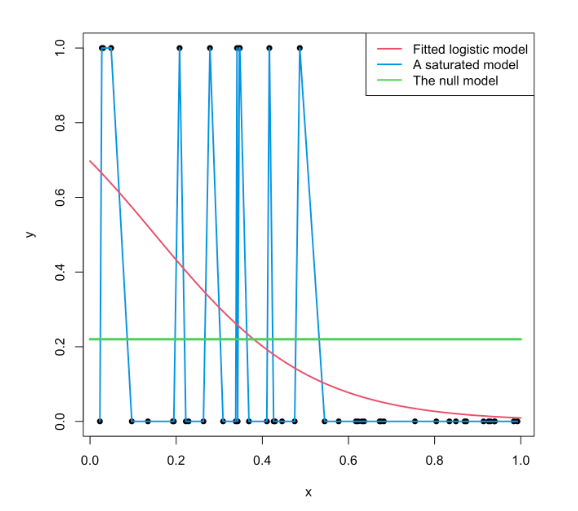

```{r}
#| label: setup
#| include: false
library(ggplot2)
library(knitr)
library(kableExtra)
library(sjPlot)
library(dplyr)
library(sjmisc)
library(ggeffects)

azul <- "#04245f"
azul_claro <- "#4f97ff"
rojo <- "#c0392b"

theme_set(theme_minimal(base_size = 16))

# --- Titanic ---
load(url("https://github.com/Kevin-carrasco/metod3-unab/raw/refs/heads/main/practicos/data/titanic.Rdata"))

tt <- tt %>%
  mutate(pclass = factor(pclass,
                         levels = c("Clase Alta", "Clase Intermedia", "Clase Baja")))

modelo_titanic <- glm(survived ~ sex, data = tt, family = "binomial")
modelo_titanic2 <- glm(survived ~ sex + age, data = tt, family = "binomial")
modelo_titanic3 <- glm(survived ~ sex + pclass, data = tt, family = "binomial")
modelo_titanic_null <- glm(survived ~ 1, data = tt, family = "binomial")

b_tt <- coef(modelo_titanic)
or_tt3 <- exp(coef(modelo_titanic3))

logit_h <- b_tt[1]
logit_m <- b_tt[1] + b_tt[2]
odds_ph <- exp(logit_h)
odds_pm <- exp(logit_m)
p_h <- odds_ph / (1 + odds_ph)
p_m <- odds_pm / (1 + odds_pm)

obs_sexo <- prop.table(table(tt$sex, tt$survived), 1)[, "Sobrevive"]

pred_tt <- ggpredict(modelo_titanic, terms = "sex")
pred_tt3 <- ggpredict(modelo_titanic3, terms = c("pclass", "sex"))
pred_tt3_df <- as.data.frame(pred_tt3)

ll_tt1 <- as.numeric(logLik(modelo_titanic))
ll_tt_null <- as.numeric(logLik(modelo_titanic_null))

# Mismo OR, distinto punto de partida
tabla_or2 <- data.frame(p0 = c(0.01, 0.10, 0.25, 0.50, 0.75, 0.90)) %>%
  mutate(odds0 = p0 / (1 - p0),
         odds1 = odds0 * 2,
         p1 = odds1 / (1 + odds1),
         dif = (p1 - p0) * 100)

# --- Participación electoral (ELSOC 2016) ---
load(url("https://github.com/Kevin-carrasco/metod3-unab/raw/refs/heads/main/files/data/elsoc16-22.RData"))

elsoc <- elsoc_long_2016_2022.2 %>%
  filter(ola == 1) %>%
  select(c11, m01, m0_sexo, m0_edad) %>%
  set_na(., na = c(-999, -888, -777, -666)) %>%
  rename("participacion" = c11,
         "educacion" = m01,
         "sexo" = m0_sexo,
         "edad" = m0_edad) %>%
  na.omit() %>%
  filter(participacion < 3) %>%          # excluye "no tenía edad para votar"
  mutate(voto = ifelse(participacion == 1, 1, 0),
         sexo_f = factor(sexo, levels = c(1, 2),
                         labels = c("Hombre", "Mujer")),
         educ_cat = case_when(educacion <= 3 ~ 1,
                              educacion <= 5 ~ 2,
                              TRUE ~ 3),
         educ_f = factor(educ_cat, levels = 1:3,
                         labels = c("Básica", "Media", "Superior")))

tabla_educ <- elsoc %>%
  group_by(educ_f) %>%
  summarise(pct = round(mean(voto) * 100, 1),
            odds = round(sum(voto) / sum(1 - voto), 3),
            edad = round(mean(edad), 1)) %>%
  mutate(OR = round(odds / first(odds), 2)) %>%
  select(educ_f, pct, odds, OR, edad)

m_null <- glm(voto ~ 1, data = elsoc, family = "binomial")
m_sexo <- glm(voto ~ sexo_f, data = elsoc, family = "binomial")
m_educ <- glm(voto ~ educ_f, data = elsoc, family = "binomial")
m_educ_edad <- glm(voto ~ educ_f + edad, data = elsoc, family = "binomial")
m_mult <- glm(voto ~ educ_f + edad + sexo_f, data = elsoc, family = "binomial")

b <- coef(m_mult)
or_mult <- exp(b)
or_sexo_biv <- exp(coef(m_sexo)[2])

# Gráfico de coeficientes
coefs <- data.frame(term = c("Educación media", "Educación superior", "Edad", "Sexo (Mujer)"),
                    or = exp(coef(m_mult))[-1],
                    low = exp(confint.default(m_mult))[-1, 1],
                    high = exp(confint.default(m_mult))[-1, 2])
coefs$term <- factor(coefs$term, levels = rev(coefs$term))

# Predicciones para todos los casos
elsoc$prob_pred <- predict(m_mult, type = "response")
lpm_mult <- lm(voto ~ educ_f + edad + sexo_f, data = elsoc)
fuera_lpm <- sum(fitted.values(lpm_mult) > 1 | fitted.values(lpm_mult) < 0)

# Perfiles calculados a mano
logit_p1 <- b[1] + b["educ_fSuperior"] + b["edad"] * 25 + b["sexo_fMujer"]
logit_p2 <- b[1] + b["educ_fSuperior"] + b["edad"] * 65 + b["sexo_fMujer"]
p_p1 <- plogis(logit_p1)
p_p2 <- plogis(logit_p2)

# Ejercicio
logit_ej <- b[1] + b["educ_fMedia"] + b["edad"] * 40
odds_ej <- exp(logit_ej)
p_ej <- plogis(logit_ej)

# Predicciones con ggeffects
pred_educ <- ggpredict(m_mult, terms = "educ_f")
pred_educ_biv <- ggpredict(m_educ, terms = "educ_f")
pred_edad_tab <- ggpredict(m_mult, terms = "edad [20,30,40,50,60,70,80]")
pred_perfiles <- ggpredict(m_mult, terms = c("edad [25,45,65]", "educ_f"))
pred_perfiles_df <- as.data.frame(pred_perfiles)

edad_media <- mean(elsoc$edad)

tabla_edad_pred <- as.data.frame(pred_edad_tab) %>%
  select(x, predicted) %>%
  mutate(diferencia = predicted - lag(predicted))

dif_20_30 <- tabla_edad_pred$diferencia[2]
dif_70_80 <- tabla_edad_pred$diferencia[7]

# Ajuste del ejemplo electoral
ll_null <- as.numeric(logLik(m_null))
resumen_ajuste <- data.frame(
  modelo = c("Nulo", "Educación", "Educación + edad", "Educación + edad + sexo"),
  ll = sapply(list(m_null, m_educ, m_educ_edad, m_mult), function(m) as.numeric(logLik(m))),
  devianza = sapply(list(m_null, m_educ, m_educ_edad, m_mult), deviance),
  aic = sapply(list(m_null, m_educ, m_educ_edad, m_mult), AIC)
) %>%
  mutate(mcfadden = 1 - ll / ll_null)
```

##  {data-background-color="black"}

::: {.columns .v-center-container}
::: {.column width="20%"}
{width="100%" fig-align="center"}
:::

::: {.column width="80%"}
### Métodos estadísticos para
### Ciencias Sociales III

------------------------------------------------------------------------

### **Kevin Carrasco**
### Sociología - UNAB
### 2do Sem 2026
### [https://metod3-unab.netlify.app/](https://metod3-unab.netlify.app/)
:::
:::

# Sesión 9 {data-background-color="black"}

Regresión logística: modelos múltiples, probabilidades predichas y ajuste

## ¿Dónde quedamos?

::: {.incremental}

- La regresión logística estima el **logit**: el logaritmo de los odds

- Del coeficiente logit leemos **signo** y **significación**

- Para interpretar la **magnitud**, exponenciamos el coeficiente y obtenemos un **odds ratio**

- En el ejemplo de participación electoral quedó una pregunta abierta: ¿qué ocurre con el efecto de la educación al controlar por edad?

:::

## Hoy

::: {.incremental}

1. Regresión logística **múltiple**

2. Del logit a la **probabilidad**

3. **Probabilidades predichas** en R con `ggeffects`

4. El efecto **no constante** de los predictores sobre la probabilidad

5. **Ajuste** de la regresión logística

:::

## Tres escalas para lo mismo

::: {.small}

| | Probabilidad | Odds | Logit |
|---|---|---|---|
| Fórmula | $p$ | $\frac{p}{1-p}$ | $ln\left(\frac{p}{1-p}\right)$ |
| Rango | 0 a 1 | 0 a $+\infty$ | $-\infty$ a $+\infty$ |
| Sin asociación | | OR = 1 | $\beta$ = 0 |
| ¿Para qué la usamos? | Comunicar resultados | Interpretar coeficientes (OR) | Es lo que estima el modelo |

:::

::: {.fragment .fade-up}

El modelo trabaja en logits. Nosotros podemos movernos entre las tres escalas **en ambas direcciones**

:::

## Ida y vuelta

::: {.columns}
::: {.column width="50%"}

**De la probabilidad al logit**

$$Odds=\frac{p}{1-p}$$

$$logit=ln(Odds)$$

:::
::: {.column width="50%"}

::: {.fragment .fade-up}

**Del logit a la probabilidad**

$$Odds=e^{logit}$$

$$p=\frac{Odds}{1+Odds}=\frac{e^{logit}}{1+e^{logit}}$$

:::

:::
:::

::: {.fragment .fade-up}

::: {.small}
La sesión pasada recorrimos el camino de ida. Hoy recorremos el de vuelta
:::

:::

# Regresión logística múltiple {data-background-color="black"}

## Regresión logística múltiple

::: {.incremental}

- Igual que en regresión lineal, podemos incluir **varios predictores** en el modelo

$$ln\left(\frac{p}{1-p}\right)=\beta_0+\beta_1X_1+\beta_2X_2+...+\beta_kX_k$$

- Cada coeficiente se interpreta **controlando** por los demás predictores, es decir, manteniéndolos constantes

- La sintaxis en R es la misma: se agregan predictores con `+`

:::

## Titanic: sexo y clase

::: {.columns}
::: {.column width="45%"}

```{r}
#| label: tt3-code
#| echo: true
#| eval: false

tt <- tt %>%
  mutate(pclass = factor(pclass,
    levels = c("Clase Alta",
               "Clase Intermedia",
               "Clase Baja")))

modelo_titanic3 <- glm(survived ~ sex + pclass,
                       data = tt,
                       family = "binomial")
```

::: {.small}
Ordenamos los niveles de `pclass` para que la categoría de referencia sea la clase alta
:::

:::
::: {.column width="55%"}

```{r}
#| label: tab-tt3
#| echo: false
#| results: asis

tab_model(modelo_titanic, modelo_titanic3,
          show.se = FALSE,
          show.ci = FALSE,
          show.r2 = FALSE,
          digits = 3,
          p.style = "stars",
          dv.labels = c("Modelo 1", "Modelo 2"),
          pred.labels = c("(Intercepto)", "Sexo (Mujer)",
                          "Clase intermedia", "Clase baja"),
          string.pred = "Predictores",
          string.est = "OR")
```

:::
:::

## Interpretación

::: {.incremental}

- **Sexo**: controlando por clase, las chances de sobrevivir de las mujeres son `r round(or_tt3["sexMujer"], 2)` veces las de los hombres

- **Clase intermedia** (ref = clase alta): controlando por sexo, sus chances de sobrevivir son `r round(or_tt3["pclassClase Intermedia"], 3)` veces las de la clase alta, es decir, un **`r round((1 - or_tt3["pclassClase Intermedia"]) * 100)`% menos**

- **Clase baja**: sus chances son `r round(or_tt3["pclassClase Baja"], 3)` veces las de la clase alta, un **`r round((1 - or_tt3["pclassClase Baja"]) * 100)`% menos**

- Todos los coeficientes son estadísticamente significativos ($p<0.001$)

:::

##  {data-background-color="black"}

### El OR de sexo casi no cambia al controlar por clase

### La ventaja de las mujeres no se explica por su distribución entre las clases

::: {.fragment .fade-up}

### En el ejemplo de participación electoral, en cambio, el control sí modifica los resultados

:::

## Volviendo a la paradoja

```{r}
#| label: tab-paradoja
#| echo: false

kable(tabla_educ,
      col.names = c("Nivel educacional", "% votó", "Odds", "OR", "Edad promedio"))
```

::: {.incremental}

- En el análisis bivariado, quienes tienen educación **básica** presentan las mayores chances de votar

- Pero también son, en promedio, **mucho mayores**, y la edad es un predictor fuerte de la participación

:::

## Los modelos

```{r}
#| label: m-mult-code
#| echo: true
#| eval: false

m_educ <- glm(voto ~ educ_f, data = elsoc, family = "binomial")

m_mult <- glm(voto ~ educ_f + edad + sexo_f, data = elsoc, family = "binomial")

tab_model(m_educ, m_mult)
```

::: {.incremental}

- **Modelo 1**: solo nivel educacional. Reproduce los OR de la tabla de contingencia

- **Modelo 2**: agrega edad y sexo como controles

:::

## Resultados (odds ratio)

```{r}
#| label: tab-mult
#| echo: false
#| results: asis

tab_model(m_educ, m_mult,
          show.se = FALSE,
          show.ci = FALSE,
          show.r2 = FALSE,
          digits = 3,
          p.style = "stars",
          dv.labels = c("Modelo 1", "Modelo 2"),
          pred.labels = c("(Intercepto)", "Educación media", "Educación superior",
                          "Edad", "Sexo (Mujer)"),
          string.pred = "Predictores",
          string.est = "OR")
```

## Interpretación

::: {.small}

::: {.incremental}

- **Educación superior** (ref = básica): controlando por edad y sexo, las chances de votar de quienes tienen educación superior son `r round(or_mult["educ_fSuperior"], 2)` veces las de quienes tienen educación básica, es decir, un **`r round((or_mult["educ_fSuperior"] - 1) * 100)`% más**. Es estadísticamente significativo ($p<0.05$)

- **Educación media**: OR de `r round(or_mult["educ_fMedia"], 2)`, no significativo. No hay diferencias con educación básica una vez que controlamos por edad y sexo

- **Edad**: cada año adicional aumenta las chances de votar en un `r round((or_mult["edad"] - 1) * 100, 1)`%, manteniendo constantes educación y sexo

- **Sexo**: las mujeres presentan un OR de `r round(or_mult["sexo_fMujer"], 2)`, pero la diferencia no es significativa

:::

:::

##  {data-background-color="black"}

### Al controlar por edad, el efecto de la educación **se invierte**

### Ahora sí coincide con lo que predice la teoría: a mayor educación, mayores chances de votar

## ¿Y el sexo?

::: {.incremental}

- En el análisis bivariado, el OR de mujer era `r round(or_sexo_biv, 2)` y estadísticamente **significativo**

- En el modelo múltiple baja a `r round(or_mult["sexo_fMujer"], 2)` y deja de ser significativo

- Una parte de esa diferencia se explicaba por la composición de edad y educación de hombres y mujeres en la muestra

:::

::: {.fragment .fade-up}

::: {.small}
Es la misma lógica de la parcialización que vimos en regresión lineal: el coeficiente de un predictor cambia cuando se incorporan otros que están relacionados con él y con la dependiente
:::

:::

## Gráfico de coeficientes

```{r}
#| label: fig-coefs
#| echo: false
#| fig-width: 9
#| fig-height: 4

ggplot(coefs, aes(x = or, y = term)) +
  geom_vline(xintercept = 1, linetype = "dashed", color = rojo) +
  geom_errorbar(aes(xmin = low, xmax = high), width = 0.15, orientation = "y", color = azul) +
  geom_point(size = 3.5, color = azul) +
  geom_text(aes(label = round(or, 2)), vjust = -1, size = 5) +
  scale_x_log10() +
  labs(x = "Odds ratio (escala logarítmica)", y = NULL)
```

::: {.small}
Un coeficiente es significativo cuando su intervalo de confianza **no cruza la línea del 1**. En R, un gráfico similar se obtiene rápidamente con `plot_model(m_mult)` del paquete `sjPlot`
:::

# Del logit a la probabilidad {data-background-color="black"}

##  {data-background-color="black"}

### El OR de educación superior es `r round(or_mult["educ_fSuperior"], 2)`

::: {.fragment .fade-up}

### ¿Significa que la **probabilidad** de votar es un `r round((or_mult["educ_fSuperior"] - 1) * 100)`% mayor?

:::

::: {.fragment .fade-up}

### **No**. Significa que las **chances** (odds) son un `r round((or_mult["educ_fSuperior"] - 1) * 100)`% mayores

:::

## Odds no son probabilidades

::: {.incremental}

- Confundir odds con probabilidades es el error **más frecuente** al interpretar una regresión logística

- El OR es una medida **relativa**: dice cuánto se multiplican las chances, pero no cuál es el punto de partida

- Para decir algo como "una persona con tales características tiene un X% de probabilidad de votar" necesitamos las **probabilidades predichas**

:::

## Un mismo OR, distintos cambios en la probabilidad

```{r}
#| label: tab-or2
#| echo: false

kable(tabla_or2, digits = 3,
      col.names = c("Probabilidad inicial", "Odds inicial", "Odds × 2",
                    "Probabilidad final", "Cambio (puntos %)"))
```

::: {.small}
En todos los casos el OR es 2, pero el cambio en la probabilidad va desde 1 punto porcentual hasta casi 17. Depende de **dónde** se parte
:::

## Paso 1: el logit predicho

- Igual que en regresión lineal, el modelo entrega un **valor predicho** reemplazando los valores de las variables en la ecuación, solo que aquí ese valor está en logits

$$logit(\hat{p})=\beta_0+\beta_1X_1+...+\beta_kX_k$$

::: {.fragment .fade-up}

**Titanic**, modelo con sexo:

- Hombres: `r round(b_tt[1], 3)` + (`r round(b_tt[2], 3)` × 0) = **`r round(logit_h, 3)`**

- Mujeres: `r round(b_tt[1], 3)` + (`r round(b_tt[2], 3)` × 1) = **`r round(logit_m, 3)`**

:::

## Paso 2: de logits a odds

- Exponenciamos el logit predicho

$$Odds=e^{logit}$$

::: {.fragment .fade-up}

$$Odds_{hombres}=e^{`r round(logit_h, 3)`}=`r round(odds_ph, 3)`$$

$$Odds_{mujeres}=e^{`r round(logit_m, 3)`}=`r round(odds_pm, 3)`$$

:::

::: {.fragment .fade-up}

::: {.small}
Son los mismos odds que calculamos desde la tabla de contingencia
:::

:::

## Paso 3: de odds a probabilidades

$$p=\frac{Odds}{1+Odds}=\frac{e^{logit}}{1+e^{logit}}$$

::: {.fragment .fade-up}

$$p_{hombres}=\frac{`r round(odds_ph, 3)`}{1+`r round(odds_ph, 3)`}=`r round(p_h, 3)`$$

$$p_{mujeres}=\frac{`r round(odds_pm, 3)`}{1+`r round(odds_pm, 3)`}=`r round(p_m, 3)`$$

:::

::: {.fragment .fade-up}

### La probabilidad predicha de sobrevivir es de `r round(p_h * 100, 1)`% para los hombres y de `r round(p_m * 100, 1)`% para las mujeres

:::

##  {data-background-color="black"}

### ¿Y cuáles eran las proporciones observadas de sobrevivencia?

::: {.fragment .fade-up}

### Hombres: `r round(obs_sexo["Hombre"] * 100, 1)`% / Mujeres: `r round(obs_sexo["Mujer"] * 100, 1)`%

:::

::: {.fragment .fade-up}

### Con un único predictor dicotómico, las probabilidades predichas **reproducen** las proporciones de cada grupo, igual que en regresión lineal el valor predicho de una dummy era el promedio de cada grupo

:::

## En R: `predict()`

```{r}
#| label: predict-titanic
#| echo: true

predict(modelo_titanic,
        newdata = data.frame(sex = c("Hombre", "Mujer")),
        type = "response")
```

::: {.incremental}

- `newdata` indica los valores de las independientes para los que queremos la predicción

- `type = "response"` pide la predicción en la escala de la **probabilidad**

- Sin ese argumento, `predict()` entrega los **logits**

:::

## Predicciones para todos los casos

::: {.columns}
::: {.column width="45%"}

```{r}
#| label: pred-todos
#| echo: true

elsoc$prob_pred <- predict(m_mult,
                           type = "response")

summary(elsoc$prob_pred)
```

::: {.small}
Sin `newdata`, `predict()` calcula la probabilidad predicha de cada persona de la muestra según sus propios valores en las independientes
:::

:::
::: {.column width="55%"}

```{r}
#| label: fig-hist-pred
#| echo: false
#| fig-width: 6
#| fig-height: 4.5

ggplot(elsoc, aes(x = prob_pred)) +
  geom_histogram(binwidth = 0.025, fill = azul, color = "white") +
  geom_vline(xintercept = c(0, 1), color = rojo, linetype = "dashed") +
  scale_x_continuous(limits = c(-0.05, 1.05), labels = scales::percent) +
  labs(x = "Probabilidad predicha de votar", y = "Frecuencia")
```

:::
:::

## ¿Y con el modelo de probabilidad lineal?

```{r}
#| label: lpm-elsoc
#| echo: true

lpm_mult <- lm(voto ~ educ_f + edad + sexo_f, data = elsoc)

summary(fitted.values(lpm_mult))

sum(fitted.values(lpm_mult) > 1 | fitted.values(lpm_mult) < 0)
```

::: {.fragment .fade-up}

Con los mismos datos y predictores, el modelo lineal entrega **`r fuera_lpm` casos** con probabilidades predichas mayores a 1. La regresión logística, ninguno

:::

# Probabilidades predichas con `ggeffects` {data-background-color="black"}

## `ggpredict()`

::: {.columns}
::: {.column width="45%"}

```{r}
#| label: ggpredict-tt-code
#| echo: true
#| eval: false

library(ggeffects)

ggpredict(modelo_titanic,
          terms = "sex")
```

::: {.small}
La misma función que usamos con regresión lineal. Con un modelo logístico, entrega directamente **probabilidades**, con sus intervalos de confianza
:::

:::
::: {.column width="55%"}

```{r}
#| label: ggpredict-tt-out
#| echo: false

kable(as.data.frame(pred_tt)[, c("x", "predicted", "conf.low", "conf.high")],
      digits = 3,
      col.names = c("Sexo", "Probabilidad", "IC inferior", "IC superior"))
```

:::
:::

## El gráfico

```{r}
#| label: fig-pred-tt
#| echo: true
#| fig-width: 9
#| fig-height: 3.8

plot(pred_tt) +
  scale_y_continuous(limits = c(0, 1), labels = scales::percent) +
  labs(title = NULL, x = "Sexo", y = "Probabilidad predicha de sobrevivir")
```

::: {.small}
Como en regresión lineal, el eje $y$ muestra el **rango completo** de la variable: de 0% a 100%
:::

## Dos predictores categóricos

```{r}
#| label: fig-pred-tt3
#| echo: true
#| fig-width: 9
#| fig-height: 3.8

plot(ggpredict(modelo_titanic3, terms = c("pclass", "sex"))) +
  scale_y_continuous(limits = c(0, 1), labels = scales::percent) +
  labs(title = NULL, x = "Clase", y = "Probabilidad predicha de sobrevivir", color = "Sexo")
```

## Cómo leerlo

::: {.incremental}

- El primer término de `terms` va en el eje $x$; el segundo, en los colores

- Una mujer de clase alta tiene una probabilidad predicha de sobrevivir de **`r round(pred_tt3_df$predicted[pred_tt3_df$x == "Clase Alta" & pred_tt3_df$group == "Mujer"] * 100)`%**

- Un hombre de clase baja, de **`r round(pred_tt3_df$predicted[pred_tt3_df$x == "Clase Baja" & pred_tt3_df$group == "Hombre"] * 100)`%**

- Los OR de clase son los mismos para hombres y mujeres, pero la distancia en puntos porcentuales cambia: entre clase alta e intermedia es de `r round((pred_tt3_df$predicted[pred_tt3_df$x == "Clase Alta" & pred_tt3_df$group == "Hombre"] - pred_tt3_df$predicted[pred_tt3_df$x == "Clase Intermedia" & pred_tt3_df$group == "Hombre"]) * 100)` puntos para los hombres y de `r round((pred_tt3_df$predicted[pred_tt3_df$x == "Clase Alta" & pred_tt3_df$group == "Mujer"] - pred_tt3_df$predicted[pred_tt3_df$x == "Clase Intermedia" & pred_tt3_df$group == "Mujer"]) * 100)` para las mujeres

:::

# Participación electoral {data-background-color="black"}

## Un perfil, paso a paso

¿Cuál es la probabilidad predicha de votar de una **mujer** de **25 años** con **educación superior**?

::: {.fragment .fade-up}

::: {.small}

$$logit=`r round(b[1], 3)`+`r round(b["educ_fSuperior"], 3)`(1)+`r round(b["edad"], 4)`(25)+`r round(b["sexo_fMujer"], 3)`(1)=`r round(logit_p1, 3)`$$

:::

:::

::: {.fragment .fade-up}

$$p=\frac{e^{`r round(logit_p1, 3)`}}{1+e^{`r round(logit_p1, 3)`}}=`r round(p_p1, 3)`$$

:::

::: {.fragment .fade-up}

### Una mujer de 25 años con educación superior tiene una probabilidad predicha de votar de **`r round(p_p1 * 100, 1)`%**

:::

## El mismo perfil, a los 65 años

::: {.small}

$$logit=`r round(b[1], 3)`+`r round(b["educ_fSuperior"], 3)`(1)+`r round(b["edad"], 4)`(65)+`r round(b["sexo_fMujer"], 3)`(1)=`r round(logit_p2, 3)`$$

$$p=\frac{e^{`r round(logit_p2, 3)`}}{1+e^{`r round(logit_p2, 3)`}}=`r round(p_p2, 3)`$$

:::

::: {.fragment .fade-up}

```{r}
#| label: predict-perfiles
#| echo: true

perfiles <- data.frame(educ_f = "Superior",
                       edad = c(25, 65),
                       sexo_f = "Mujer")

predict(m_mult, newdata = perfiles, type = "response")
```

:::

::: {.fragment .fade-up}

::: {.small}
40 años de diferencia significan pasar de `r round(p_p1 * 100)`% a `r round(p_p2 * 100)`% de probabilidad de votar
:::

:::

## Ejercicio

¿Cuál es la probabilidad predicha de votar de un **hombre** de **40 años** con **educación media**?

::: {.small}

| Término | Coeficiente logit |
|---|---|
| Intercepto | `r round(b[1], 4)` |
| Educación media | `r round(b["educ_fMedia"], 4)` |
| Educación superior | `r round(b["educ_fSuperior"], 4)` |
| Edad | `r round(b["edad"], 4)` |
| Sexo (Mujer) | `r round(b["sexo_fMujer"], 4)` |

:::

## Solución

::: {.incremental}

- **Logit**: `r round(b[1], 3)` + (`r round(b["educ_fMedia"], 3)` × 1) + (`r round(b["edad"], 4)` × 40) + (`r round(b["sexo_fMujer"], 3)` × 0) = **`r round(logit_ej, 3)`**

- **Odds**: $e^{`r round(logit_ej, 3)`}=`r round(odds_ej, 3)`$

- **Probabilidad**: $\frac{`r round(odds_ej, 3)`}{1+`r round(odds_ej, 3)`}=`r round(p_ej, 3)`$

:::

::: {.fragment .fade-up}

### Un hombre de 40 años con educación media tiene una probabilidad predicha de votar de **`r round(p_ej * 100, 1)`%**

:::

## Probabilidades predichas según educación

::: {.columns}
::: {.column width="45%"}

```{r}
#| label: ggpredict-educ-code
#| echo: true
#| eval: false

ggpredict(m_mult,
          terms = "educ_f")
```

::: {.small}

::: {.incremental}

- `ggpredict` fija las demás variables: las continuas en su **promedio** (edad = `r round(edad_media, 1)` años) y las categóricas en su **categoría de referencia** (hombre)

- Es decir, compara niveles educacionales entre personas **de la misma edad y sexo**

:::

:::

:::
::: {.column width="55%"}

```{r}
#| label: ggpredict-educ-out
#| echo: false

kable(as.data.frame(pred_educ)[, c("x", "predicted", "conf.low", "conf.high")],
      digits = 3,
      col.names = c("Educación", "Probabilidad", "IC inferior", "IC superior"))
```

:::
:::

## Antes y después de controlar

```{r}
#| label: fig-comparacion
#| echo: false
#| fig-width: 10
#| fig-height: 4.6

comparacion <- bind_rows(
  as.data.frame(pred_educ_biv) %>% mutate(modelo = "Modelo 1: sin controles"),
  as.data.frame(pred_educ) %>% mutate(modelo = "Modelo 2: controlando por edad y sexo")
)

ggplot(comparacion, aes(x = x, y = predicted, color = modelo)) +
  geom_point(size = 3.5, position = position_dodge(width = 0.4)) +
  geom_errorbar(aes(ymin = conf.low, ymax = conf.high),
                width = 0.15, position = position_dodge(width = 0.4)) +
  scale_color_manual(values = c(azul_claro, azul)) +
  scale_y_continuous(limits = c(0, 1), labels = scales::percent) +
  labs(x = "Nivel educacional", y = "Probabilidad predicha de votar", color = NULL) +
  theme(legend.position = "bottom")
```

::: {.small}
Sin controles, las probabilidades predichas reproducen el porcentaje de votantes de cada grupo. Al controlar por edad, educación superior pasa a tener la **mayor** probabilidad
:::

## Probabilidades predichas según edad

```{r}
#| label: fig-pred-edad
#| echo: true
#| fig-width: 9
#| fig-height: 3.8

plot(ggpredict(m_mult, terms = "edad [18:88]")) +
  scale_y_continuous(limits = c(0, 1), labels = scales::percent) +
  labs(title = NULL, x = "Edad", y = "Probabilidad predicha de votar")
```

::: {.small}
`[18:88]` pide la predicción para cada edad entre 18 y 88 años. Es una **curva**, no una recta
:::

##  {data-background-color="black"}

### El OR de la edad es el mismo para cualquier año: `r round(or_mult["edad"], 3)`

### Pero ¿el efecto sobre la **probabilidad** también es el mismo?

## El efecto no es constante

::: {.columns}
::: {.column width="50%"}

```{r}
#| label: tab-edad-pred
#| echo: false

kable(tabla_edad_pred, digits = 3,
      col.names = c("Edad", "Probabilidad", "Diferencia"))
```

:::
::: {.column width="50%"}

::: {.small}

::: {.incremental}

- Entre los 20 y los 30 años, la probabilidad de votar aumenta **`r round(dif_20_30 * 100, 1)` puntos porcentuales**

- Entre los 70 y los 80 años, solo **`r round(dif_70_80 * 100, 1)` puntos**

- Las chances se multiplican siempre por lo mismo, pero el cambio en la probabilidad depende del **punto de partida**

- Cerca de 0 o de 1 la curva se aplana: la probabilidad ya no puede crecer (o bajar) mucho más

:::

:::

:::
:::

##  {data-background-color="black"}

### En regresión lineal, el efecto de $x$ es el **mismo** en todo su rango

### En regresión logística, el efecto sobre la probabilidad **depende de los valores** de todas las variables del modelo

::: {.fragment .fade-up}

### Por eso las probabilidades predichas se reportan para **perfiles** concretos

:::

## Edad y educación a la vez

```{r}
#| label: fig-edad-educ
#| echo: true
#| fig-width: 9
#| fig-height: 3.8

plot(ggpredict(m_mult, terms = c("edad [18:88]", "educ_f"))) +
  scale_y_continuous(limits = c(0, 1), labels = scales::percent) +
  labs(title = NULL, x = "Edad", y = "Probabilidad predicha de votar", color = "Educación")
```

::: {.small}
La distancia entre las curvas es mayor donde la probabilidad está más cerca de 50% (los más jóvenes) y se achica en las edades altas, donde todas se acercan a 1
:::

## Tabla de perfiles

```{r}
#| label: perfiles-code
#| echo: true
#| eval: false

ggpredict(m_mult, terms = c("edad [25,45,65]", "educ_f"))
```

```{r}
#| label: perfiles-out
#| echo: false

pred_perfiles_df %>%
  select(x, group, predicted) %>%
  tidyr::pivot_wider(names_from = group, values_from = predicted) %>%
  kable(digits = 3, col.names = c("Edad", "Básica", "Media", "Superior"))
```

::: {.small}
Probabilidades predichas de votar para hombres, según edad y nivel educacional
:::

## Una alternativa: `sjPlot`

```{r}
#| label: fig-plot-model-pred
#| echo: true
#| fig-width: 9
#| fig-height: 3.8

plot_model(m_mult, type = "pred", terms = "educ_f") +
  scale_y_continuous(limits = c(0, 1), labels = scales::percent) +
  labs(title = NULL, x = "Nivel educacional", y = "Probabilidad predicha de votar")
```

::: {.small}
`plot_model` con `type = "pred"` usa por dentro `ggeffects`, por lo que entrega las mismas probabilidades
:::

## Cómo reportar

::: {.incremental}

- **Coeficientes**: en odds ratio, indicando significación. "Controlando por edad y sexo, las chances de votar de quienes tienen educación superior son `r round(or_mult["educ_fSuperior"], 2)` veces las de quienes tienen educación básica"

- **Probabilidades predichas**: para perfiles relevantes, en una tabla o un gráfico. "Un hombre de 25 años con educación superior tiene una probabilidad predicha de votar de `r round(pred_perfiles_df$predicted[pred_perfiles_df$x == 25 & pred_perfiles_df$group == "Superior"] * 100)`%, frente a un `r round(pred_perfiles_df$predicted[pred_perfiles_df$x == 65 & pred_perfiles_df$group == "Superior"] * 100)`% a los 65 años"

- Las probabilidades son la forma más **comunicable** de los resultados

:::

# Ajuste {data-background-color="black"}

## Ajuste: ¿Qué tan bueno es nuestro modelo?

::: {.incremental}

- **Distinto** a regresión OLS: no hay varianza en una dependiente dicotómica, por lo que no existe el $R^2$ tal como lo conocemos

- Para evaluar ajuste se utiliza la **log-verosimilitud** (*log-likelihood*), que se asocia a la idea de **residuos** del modelo

- La log-verosimilitud del modelo se obtiene del proceso de estimación por **máxima verosimilitud** (tema para otro curso)

:::

## Log-verosimilitud

```{r}
#| label: loglik
#| echo: true

logLik(modelo_titanic)   # sexo
logLik(modelo_titanic2)  # sexo + edad
```

::: {.fragment .fade-up}

La inclusión de un predictor adicional (edad) hace que cambie la log-verosimilitud del modelo. Mientras **más cercana a 0**, mejor ajuste

:::

## Ajuste: ¿Qué tan bueno es nuestro modelo?

::: {.incremental}

- No existe una **única forma** de estimar el ajuste en regresión logística

- El ajuste de los modelos logísticos se evalúa en general en términos **comparativos** con otros modelos

- Estas medidas de comparación se basan en distintas fórmulas que consideran la **log-verosimilitud** (LL) y la **devianza**

:::

## Modelo saturado, nulo y logístico

{width="70%" fig-align="center"}

## Indicadores de ajuste

Entre las medidas de ajuste usualmente se consideran:

::: {.incremental}

- Devianza

- Test de razón de verosimilitud (*likelihood ratio test*)

- Pseudo $R^2$

- Criterio de información de Akaike (AIC)

:::

## Devianza

::: {.incremental}

- El modelo saturado es básicamente residuos, y la devianza indica cuánto se han reducido los residuos a medida que se introducen parámetros al modelo. Por eso también se conoce como **devianza residual**

- Fórmula: $Devianza=-2 \times log\ likelihood$

:::

::: {.fragment .fade-up}

```{r}
#| label: devianza
#| echo: true

-2 * logLik(modelo_titanic)
modelo_titanic$deviance
```

:::

## Test de razón de verosimilitud (LRT)

- Se comparan las devianzas de distintos modelos: si la devianza es **significativamente menor**, el modelo es mejor

```{r}
#| label: lrt-tt2
#| echo: true

anova(modelo_titanic, modelo_titanic2, test = "Chisq")
```

::: {.fragment .fade-up}

::: {.small}
La diferencia entre los modelos **no** es estadísticamente significativa. El modelo con dos predictores (sexo + edad) no ofrece un mejor ajuste a los datos que el modelo con solo un predictor (sexo)
:::

:::

## Test de razón de verosimilitud

Probemos ahora con el modelo que incorpora la clase

```{r}
#| label: lrt-tt3
#| echo: true

anova(modelo_titanic, modelo_titanic3, test = "Chisq")
```

::: {.fragment .fade-up}

::: {.small}
La diferencia es estadísticamente significativa ($p<0.001$). El modelo con sexo y clase ofrece un mejor ajuste que el modelo solo con sexo
:::

:::

## Comparación con el modelo nulo

- El modelo **nulo** no tiene predictores, solo intercepto. Es el equivalente a predecir con el promedio en el caso de variables continuas

```{r}
#| label: lrt-null
#| echo: true

modelo_titanic_null <- glm(survived ~ 1, data = tt, family = "binomial")

anova(modelo_titanic_null, modelo_titanic3, test = "Chisq")
```

## McFadden (pseudo) R²

$$R^2_{McFadden}=1-\frac{LL_{modelo}}{LL_{nulo}}$$

```{r}
#| label: mcfadden
#| echo: true

logLik(modelo_titanic); logLik(modelo_titanic_null)

1 - (-551 / -707)
```

::: {.fragment .fade-up}

::: {.small}
Se usa para **comparar** modelos. **No** se interpreta como porcentaje de varianza explicada
:::

:::

## McFadden (pseudo) R²

También se puede obtener con la función `PseudoR2` de la librería `DescTools`, junto a otras versiones de pseudo $R^2$:

```{r}
#| label: pseudor2
#| echo: true

DescTools::PseudoR2(modelo_titanic3, which = c("McFadden", "Nagelkerke", "CoxSnell"))
```

## Akaike (AIC)

- Evalúa la calidad del modelo a través de la comparación con otros modelos, **penalizando** por la inclusión de predictores (análogo al $R^2$ ajustado)

$$AIC=-2(log\ likelihood)+2K$$

::: {.small}
Donde K = número de parámetros del modelo (predictores + intercepto). A **menor** AIC, mejor ajuste
:::

::: {.fragment .fade-up}

$$AIC_{sexo}=-2(`r round(ll_tt1)`)+2(2)=`r -2 * round(ll_tt1)`+4=`r -2 * round(ll_tt1) + 4`$$

:::

## Akaike (AIC)

```{r}
#| label: aic
#| echo: true

AIC(modelo_titanic, modelo_titanic2, modelo_titanic3)
```

::: {.incremental}

- Agregar edad **aumenta** el AIC: el predictor adicional no compensa la penalización

- Agregar clase lo **reduce** de forma importante: es el modelo con mejor ajuste

:::

## Aplicado a la participación electoral

```{r}
#| label: lrt-elsoc
#| echo: true

anova(m_educ, m_educ_edad, m_mult, test = "Chisq")
```

::: {.fragment .fade-up}

::: {.small}
`anova` puede comparar varios modelos a la vez, cada uno con el anterior. Agregar la edad mejora significativamente el ajuste; agregar sexo, no
:::

:::

## Resumen de ajuste: participación electoral

```{r}
#| label: tab-ajuste-elsoc
#| echo: false

kable(resumen_ajuste, digits = 3,
      col.names = c("Modelo", "Log-verosimilitud", "Devianza", "AIC", "McFadden R²"))
```

::: {.incremental}

- El gran salto en el ajuste ocurre al incorporar la **edad**

- Sexo prácticamente no cambia la log-verosimilitud ni el AIC

:::

## Resumen ajuste

::: {.incremental}

- Diferentes aproximaciones

- Utilizar más de una forma

- En general: LRT (test de razón de verosimilitud) y algún tipo de pseudo $R^2$

:::

##  {data-background-color="black"}

### Resumen

::: {.incremental}

- La regresión logística múltiple permite el **control estadístico**: cada OR se interpreta manteniendo constantes los demás predictores

- Los odds ratio indican cuánto se multiplican las chances, pero **no** son probabilidades

- Las **probabilidades predichas** se obtienen transformando el logit: $p=\frac{e^{logit}}{1+e^{logit}}$

- El efecto de un predictor sobre la probabilidad **no es constante**: depende del perfil, por lo que se reporta para valores concretos

- El ajuste se evalúa comparando modelos mediante la **log-verosimilitud**

:::

## Siguiente sesión

::: {.incremental}

- **Prueba 2**

:::

##  {data-background-color="black"}

::: {.columns .v-center-container}
::: {.column width="20%"}
{width="80%" fig-align="right"}
:::

::: {.column width="80%"}
### Métodos estadísticos para Ciencias Sociales III

------------------------------------------------------------------------

### **Kevin Carrasco**
### Sociología - UNAB
### 2do Sem 2026
### [https://metod3-unab.netlify.app/](https://metod3-unab.netlify.app/)
:::
:::
