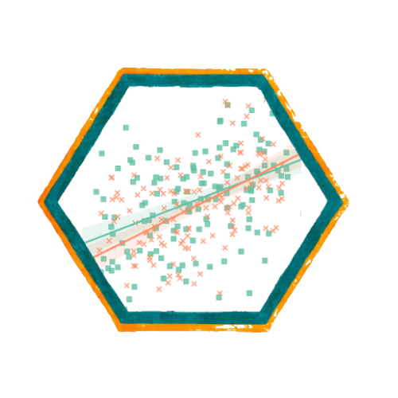
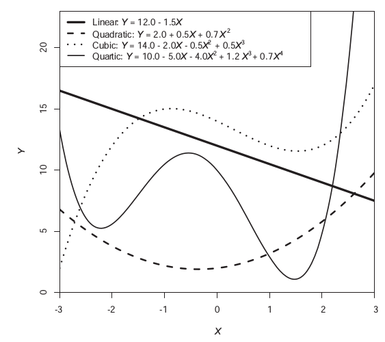
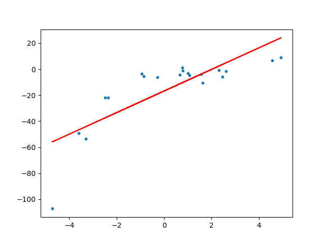
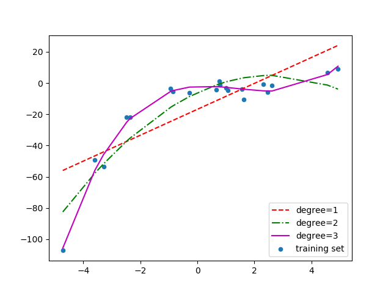
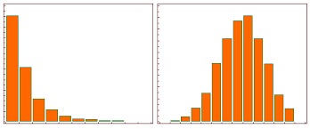
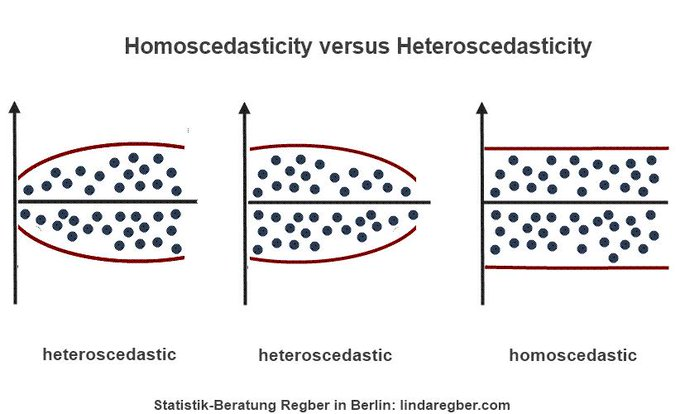

```{r}
#| label: setup
#| include: false
library(ggplot2)
library(knitr)
library(kableExtra)
library(sjPlot)
library(dplyr)
library(sjmisc)
library(lmtest)
library(sandwich)

azul <- "#04245f"
azul_claro <- "#4f97ff"
rojo <- "#c0392b"

theme_set(theme_minimal(base_size = 16))

# --- Anscombe ---
ans_long <- data.frame(
  x = c(anscombe$x1, anscombe$x2, anscombe$x3, anscombe$x4),
  y = c(anscombe$y1, anscombe$y2, anscombe$y3, anscombe$y4),
  grupo = rep(c("Datos 1", "Datos 2", "Datos 3", "Datos 4"), each = 11)
)

a1 <- lm(y ~ x, data = filter(ans_long, grupo == "Datos 1"))
a2 <- lm(y ~ x, data = filter(ans_long, grupo == "Datos 2"))
a3 <- lm(y ~ x, data = filter(ans_long, grupo == "Datos 3"))
a4 <- lm(y ~ x, data = filter(ans_long, grupo == "Datos 4"))

ans_resid <- data.frame(
  predichos = c(fitted(a1), fitted(a2), fitted(a3), fitted(a4)),
  residuos = c(resid(a1), resid(a2), resid(a3), resid(a4)),
  grupo = rep(c("Datos 1", "Datos 2", "Datos 3", "Datos 4"), each = 11)
)

# --- ELSOC: participación política no electoral ---
load(url("https://github.com/Kevin-carrasco/metod3-unab/raw/refs/heads/main/files/data/elsoc16-22.RData"))

proc_data <- elsoc_long_2016_2022.2 %>%
  filter(ola == 1) %>%
  select(c08_01, c08_02, c08_03, c08_04, m0_sexo, m0_edad, m01, m29, nhogar1, c15) %>%
  set_na(., na = c(-999, -888, -777, -666)) %>%
  rename("sexo" = m0_sexo,
         "edad" = m0_edad,
         "educacion" = m01,
         "ingreso_hogar" = m29,
         "n_hogar" = nhogar1,
         "pospol" = c15) %>%
  na.omit() %>%
  filter(ingreso_hogar > 0) %>%
  mutate(participacion = (c08_01 - 1) + (c08_02 - 1) + (c08_03 - 1) + (c08_04 - 1),
         sexo_f = factor(sexo, levels = c(1, 2), labels = c("Hombre", "Mujer")),
         educ_f = factor(case_when(educacion <= 3 ~ 1,
                                   educacion <= 5 ~ 2,
                                   TRUE ~ 3),
                         levels = c(1, 2, 3),
                         labels = c("Educación básica", "Educación media", "Educación superior")),
         ing_pc = ingreso_hogar / n_hogar / 100000,
         pospol_f = factor(case_when(pospol >= 6 & pospol <= 10 ~ 1,
                                     pospol == 5 ~ 2,
                                     pospol <= 4 ~ 3,
                                     pospol >= 11 ~ 4),
                           levels = c(1, 2, 3, 4),
                           labels = c("Derecha", "Centro", "Izquierda", "Independiente / ninguna")),
         id = row_number())

pct_cero <- mean(proc_data$participacion == 0) * 100

# Modelo 1: todos los casos
m1 <- lm(participacion ~ sexo_f + edad + educ_f + ing_pc + pospol_f, data = proc_data)
proc_data$cook <- cooks.distance(m1)
corte1 <- 4 / (nobs(m1) - length(coef(m1)) - 1)
caso_extremo <- proc_data %>% filter(cook == max(cook))

# Modelo 2: sin el caso extremo
proc_data2 <- proc_data %>% filter(id != caso_extremo$id)
m2 <- lm(participacion ~ sexo_f + edad + educ_f + ing_pc + pospol_f, data = proc_data2)
proc_data2$cook <- cooks.distance(m2)
corte2 <- 4 / (nobs(m2) - length(coef(m2)) - 1)
n_sobre <- sum(proc_data2$cook > corte2)

perfil_infl <- proc_data2 %>%
  mutate(influyente = ifelse(cook > corte2, "Sobre el corte", "Bajo el corte")) %>%
  group_by(influyente) %>%
  summarise(n = n(),
            participacion = round(mean(participacion), 2),
            izquierda = round(mean(pospol_f == "Izquierda") * 100, 1))

# Modelo 3: sin casos sobre el corte
m3 <- lm(participacion ~ sexo_f + edad + educ_f + ing_pc + pospol_f,
         data = filter(proc_data2, cook <= corte2))

# Transformaciones
proc_data2 <- proc_data2 %>%
  mutate(edad2 = edad^2,
         ln_ing = log(ing_pc))

m4 <- lm(participacion ~ sexo_f + edad + edad2 + educ_f + ing_pc + pospol_f, data = proc_data2)
m5 <- lm(participacion ~ sexo_f + edad + educ_f + ln_ing + pospol_f, data = proc_data2)

b_ln <- coef(m5)["ln_ing"]

# Errores robustos
robusto <- coeftest(m5, vcov = vcovHC(m5, type = "HC3"))
bp <- bptest(m5)
```

##  {data-background-color="black"}

::: {.columns .v-center-container}
::: {.column width="20%"}
{width="100%" fig-align="center"}
:::

::: {.column width="80%"}
### Métodos estadísticos para
### Ciencias Sociales III

------------------------------------------------------------------------

### **Kevin Carrasco**
### Sociología - UNAB
### 2do Sem 2026
### [https://metod3-unab.netlify.app/](https://metod3-unab.netlify.app/)
:::
:::

# Sesión 10 {data-background-color="black"}

Supuestos de regresión

## ¿Dónde estamos?

::: {.incremental}

- **Primera parte del curso**: regresión lineal simple y múltiple, inferencia, ajuste, predictores categóricos

- **Segunda parte**: regresión logística para dependientes dicotómicas

- **Hoy**: volvemos a la regresión lineal para preguntarnos si el modelo es una buena representación de los datos

- Estos diagnósticos son parte del **trabajo final**

:::

## Hoy

::: {.incremental}

1. ¿Por qué revisar los supuestos?

2. **Casos influyentes**

3. **Linealidad**

4. **Homocedasticidad**

5. **Multicolinealidad**

:::

# ¿Por qué revisar los supuestos? {data-background-color="black"}

##  {data-background-color="black"}

### ¿Qué tan apropiado es el modelo de regresión para dar cuenta de las relaciones entre los datos?

## Cuatro bases de datos

```{r}
#| label: tab-anscombe
#| echo: false
#| results: asis

tab_model(a1, a2, a3, a4,
          show.se = TRUE,
          show.ci = FALSE,
          digits = 2,
          p.style = "stars",
          dv.labels = c("Datos 1", "Datos 2", "Datos 3", "Datos 4"),
          pred.labels = c("(Intercepto)", "x"),
          string.pred = "Predictores",
          string.est = "β")
```

::: {.small}
Cuatro regresiones con prácticamente el mismo intercepto, la misma pendiente, la misma significación y el mismo $R^2$
:::

## Los mismos resultados, pero ...

```{r}
#| label: fig-anscombe
#| echo: false
#| fig-width: 10
#| fig-height: 5

ggplot(ans_long, aes(x = x, y = y)) +
  geom_point(size = 2.5, color = azul) +
  geom_abline(intercept = 3, slope = 0.5, color = rojo) +
  facet_wrap(~grupo, ncol = 2) +
  labs(x = NULL, y = NULL)
```

::: {.small}
Anscombe, F. J. (1973). Graphs in Statistical Analysis. *The American Statistician*, 27(1), 17-21. <https://doi.org/10.1080/00031305.1973.10478966>
:::

##  {data-background-color="black"}

{width="40%" fig-align="center"}

## Robustez del modelo

::: {.incremental}

- El modelo de regresión está pensado para asociaciones **lineales** entre variables

- Cuando los datos no cumplen ciertas condiciones, la estimación puede **distorsionarse**: los coeficientes, sus errores estándar o ambos

- El **análisis de robustez** o **diagnóstico de supuestos** permite evaluar en qué medida el modelo es una representación adecuada de las asociaciones entre las variables

:::

## A revisar

::: {.columns}
::: {.column width="60%"}

1. Casos influyentes

2. Linealidad

3. Homogeneidad de varianza (homocedasticidad)

4. Multicolinealidad

:::
::: {.column width="40%"}

:::
:::

## El ejemplo de hoy

::: {.incremental}

- **Pregunta**: ¿qué características se asocian con la participación política no electoral?

- **Dependiente**: índice de participación (0 a 16), que suma la frecuencia con que la persona firma peticiones, asiste a marchas, participa en huelgas y opina en redes sociales sobre temas públicos

- **Predictores**: sexo, edad, nivel educacional, ingreso per cápita del hogar y posición política

- **Datos**: ELSOC 2016, `r nrow(proc_data)` casos

:::

## El índice de participación

```{r}
#| label: fig-part
#| echo: false
#| fig-width: 9
#| fig-height: 4

ggplot(proc_data, aes(x = participacion)) +
  geom_bar(fill = azul) +
  labs(x = "Índice de participación", y = "Frecuencia")
```

::: {.small}
Un `r round(pct_cero)`% de las personas nunca ha realizado ninguna de las cuatro acciones. Esta concentración en 0 tendrá consecuencias en el diagnóstico
:::

## Modelo 1

```{r}
#| label: tab-m1
#| echo: false
#| results: asis

tab_model(m1,
          show.ci = FALSE,
          p.style = "stars",
          digits = 3,
          dv.labels = "Participación",
          pred.labels = c("(Intercepto)", "Mujer", "Edad", "Educación media",
                          "Educación superior", "Ingreso per cápita",
                          "Centro", "Izquierda", "Independiente / ninguna"),
          string.pred = "Predictores",
          string.est = "β")
```

# 1. Casos influyentes {data-background-color="black"}

## A revisar

::: {.columns}
::: {.column width="60%"}

1. **Casos influyentes**

2. Linealidad

3. Homogeneidad de varianza (homocedasticidad)

4. Multicolinealidad

:::
::: {.column width="40%"}

:::
:::

## Volviendo a Anscombe

```{r}
#| label: fig-anscombe34
#| echo: false
#| fig-width: 10
#| fig-height: 4

ggplot(filter(ans_long, grupo %in% c("Datos 3", "Datos 4")), aes(x = x, y = y)) +
  geom_point(size = 2.5, color = azul) +
  geom_abline(intercept = 3, slope = 0.5, color = rojo) +
  facet_wrap(~grupo, ncol = 2) +
  labs(x = NULL, y = NULL)
```

::: {.fragment .fade-up}

Una observación es **influyente** si su presencia o ausencia genera un cambio importante en la estimación de los coeficientes de regresión

:::

## Outliers y casos influyentes

::: {.incremental}

- Que un caso sea un valor extremo (*outlier*) en una variable no implica necesariamente que sea influyente

- La capacidad de influencia de un outlier se asocia al concepto de **apalancamiento** (*leverage*): su capacidad de "mover" la recta

:::

::: {.fragment .fade-up}

### No todo outlier es una observación influyente, pero toda observación influyente es un outlier

:::

## Distancia de Cook

$$D_{Cook}=\frac{\sum(\hat{y}_{j}-\hat{y}_{j(i)})^2}{p \times MSE}$$

::: {.incremental}

- Compara la predicción del modelo **con** y **sin** la observación $i$, ponderada por el número de parámetros (p) y la media cuadrática del error (MSE)

- Se usa como punto de corte $4/(n-k-1)$. Los valores mayores se consideran influyentes

- En R: `cooks.distance(modelo)`

:::

## Distancia de Cook en el Modelo 1

```{r}
#| label: fig-cook1
#| echo: false
#| fig-width: 10
#| fig-height: 4.2

ggplot(proc_data, aes(x = id, y = cook)) +
  geom_segment(aes(xend = id, yend = 0), color = azul) +
  geom_point(size = 0.8, color = azul) +
  geom_hline(yintercept = corte1, color = rojo, linetype = "dashed") +
  labs(x = "Observación", y = "Distancia de Cook")
```

::: {.small}
Un caso tiene una distancia de Cook de `r round(caso_extremo$cook, 1)`. El punto de corte es `r round(corte1, 4)`
:::

## ¿Quién es?

```{r}
#| label: caso-extremo
#| echo: true

proc_data %>%
  filter(cook == max(cook)) %>%
  select(ingreso_hogar, n_hogar, ing_pc, cook)
```

::: {.incremental}

- Un hogar de dos personas que declara un ingreso de **4.000 millones de pesos mensuales**

- Lo más probable es que se trate de un **error de registro**

- Es una buena razón sustantiva para excluirlo

:::

## Sin el caso extremo

```{r}
#| label: fig-cook2
#| echo: false
#| fig-width: 10
#| fig-height: 4.2

ggplot(proc_data2, aes(x = id, y = cook)) +
  geom_segment(aes(xend = id, yend = 0), color = azul) +
  geom_point(size = 0.8, color = azul) +
  geom_hline(yintercept = corte2, color = rojo, linetype = "dashed") +
  labs(x = "Observación", y = "Distancia de Cook")
```

::: {.small}
Todavía hay **`r n_sobre` casos** sobre el punto de corte. ¿Los eliminamos también?
:::

## Antes de decidir: ¿quiénes son?

```{r}
#| label: tab-perfil
#| echo: false

kable(perfil_infl,
      col.names = c("", "N", "Participación promedio", "% izquierda"))
```

::: {.incremental}

- Los casos sobre el corte son, sobre todo, las personas que **más participan**

- Y el doble de ellos se ubica en la izquierda

- No son errores: son justamente el fenómeno que queremos estudiar

:::

## Comparación {.scrollable}

```{r}
#| label: tab-cook
#| echo: false
#| results: asis

tab_model(m1, m2, m3,
          show.ci = FALSE,
          show.se = FALSE,
          p.style = "stars",
          digits = 3,
          dv.labels = c("M1: todos", "M2: sin caso extremo", "M3: sin casos sobre el corte"),
          pred.labels = c("(Intercepto)", "Mujer", "Edad", "Educación media",
                          "Educación superior", "Ingreso per cápita",
                          "Centro", "Izquierda", "Independiente / ninguna"),
          string.pred = "Predictores",
          string.est = "β")
```

##  {data-background-color="black"}

### El punto de corte sirve para **identificar** casos que merecen revisión

### Excluirlos es una **decisión** que debe justificarse

::: {.fragment .fade-up}

### Si los casos son válidos: estimar el modelo con y sin ellos, reportar ambos y comentar si las conclusiones cambian

:::

## Manejo de casos influyentes

::: {.incremental}

1. Calcular la distancia de Cook para todas las observaciones

2. Identificar los casos sobre el punto de corte

3. **Revisar** quiénes son: ¿errores de registro o casos válidos?

4. Reestimar el modelo sin ellos y comparar los resultados

5. Informar la decisión tomada

:::

# 2. Linealidad {data-background-color="black"}

## A revisar

::: {.columns}
::: {.column width="60%"}

1. Casos influyentes

2. **Linealidad**

3. Homogeneidad de varianza (homocedasticidad)

4. Multicolinealidad

:::
::: {.column width="40%"}

:::
:::

## Linealidad

Recordando:

- Valores predichos: $\hat{Y}$
- Residuos: $Y-\hat{Y}$

::: {.fragment .fade-up}

Una forma de evaluar la linealidad es a través de la **distribución de los residuos**

En presencia de linealidad se espera que los residuos se distribuyan **aleatoriamente** en torno a 0 para todos los valores predichos

:::

## Residuos y predichos en Anscombe

```{r}
#| label: fig-resid-ans
#| echo: false
#| fig-width: 10
#| fig-height: 5

ggplot(ans_resid, aes(x = predichos, y = residuos)) +
  geom_hline(yintercept = 0, color = rojo) +
  geom_point(size = 2.5, color = azul) +
  facet_wrap(~grupo, ncol = 2) +
  labs(x = "Valores predichos", y = "Residuos")
```

## Residuos y predichos en Anscombe

```{r}
#| label: fig-resid-ans-loess
#| echo: false
#| fig-width: 10
#| fig-height: 5

ggplot(ans_resid, aes(x = predichos, y = residuos)) +
  geom_hline(yintercept = 0, color = rojo) +
  geom_point(size = 2.5, color = azul) +
  geom_smooth(method = "loess", se = TRUE, color = "gray30") +
  facet_wrap(~grupo, ncol = 2) +
  labs(x = "Valores predichos", y = "Residuos")
```

## Interpretación del gráfico de diagnóstico

::: {.incremental}

- Los residuos deben ser **independientes** de los valores predichos

- Cualquier correlación entre residuos y valores predichos viola este supuesto

- Si los residuos muestran un patrón no lineal, como una **relación curvilínea**, el modelo está especificado incorrectamente

:::

## En el ejemplo

```{r}
#| label: fig-resid-elsoc
#| echo: false
#| fig-width: 10
#| fig-height: 4.3

ggplot(data.frame(predichos = fitted(m2), residuos = resid(m2)),
       aes(x = predichos, y = residuos)) +
  geom_point(alpha = 0.3, color = azul) +
  geom_hline(yintercept = 0, color = rojo) +
  geom_smooth(se = FALSE, color = "gray30") +
  labs(x = "Valores predichos", y = "Residuos")
```

::: {.small}
Las líneas diagonales inferiores corresponden a las personas con participación 0: como el índice no puede bajar de 0, su residuo queda determinado por su valor predicho
:::

## ¿Qué hacer en caso de no linealidad?

::: {.incremental}

- Revisar las observaciones influyentes

- Transformar las variables:

    - **Polinomial**: para relaciones curvas
    - **Logarítmica**: para variables muy asimétricas

:::

## Transformación polinomial

::: {.columns}
::: {.column width="50%"}

::: {.incremental}

- Transformaciones de potencia que permiten capturar asociaciones **curvas**

- Además de la variable original $x$, se agregan al modelo términos cuadráticos $x^2$, cúbicos $x^3$ ...

- Caso típico: **edad**

:::

:::
::: {.column width="50%"}

:::
:::

## Transformación polinomial

::: {.columns}
::: {.column width="50%"}

:::
::: {.column width="50%"}

:::
:::

## Edad al cuadrado en el ejemplo

```{r}
#| label: edad2
#| echo: true

proc_data2$edad2 <- proc_data2$edad^2

m4 <- lm(participacion ~ sexo_f + edad + edad2 + educ_f + ing_pc + pospol_f,
         data = proc_data2)

summary(m4)$coefficients[c("edad", "edad2"), ]
```

::: {.fragment .fade-up}

::: {.small}
El término cuadrático no es significativo: la relación entre edad y participación no presenta una curvatura relevante. **No todas las transformaciones mejoran el modelo**
:::

:::

## Transformación logarítmica

::: {.columns}
::: {.column width="50%"}

::: {.incremental}

- Se utiliza para variables con una distribución muy **asimétrica**

- Comprime las diferencias en la parte alta de la distribución

- Se **reemplaza** la variable original por su logaritmo (a diferencia del polinomio, que se agrega)

- Caso típico: **ingreso**

:::

:::
::: {.column width="50%"}

:::
:::

## El ingreso en el ejemplo

::: {.columns}
::: {.column width="50%"}

```{r}
#| label: fig-ing
#| echo: false
#| fig-width: 5.5
#| fig-height: 4.5

ggplot(proc_data2, aes(x = ing_pc)) +
  geom_histogram(bins = 50, fill = azul) +
  labs(title = "Ingreso per cápita", x = "Cientos de miles de pesos", y = "Frecuencia")
```

:::
::: {.column width="50%"}

```{r}
#| label: fig-ln-ing
#| echo: false
#| fig-width: 5.5
#| fig-height: 4.5

ggplot(proc_data2, aes(x = ln_ing)) +
  geom_histogram(bins = 50, fill = azul) +
  labs(title = "Logaritmo del ingreso per cápita", x = "ln(ingreso)", y = "Frecuencia")
```

:::
:::

## Comparación

```{r}
#| label: tab-log
#| echo: false
#| results: asis

tab_model(m2, m5,
          terms = c("ing_pc", "ln_ing"),
          show.ci = FALSE,
          show.se = TRUE,
          p.style = "stars",
          digits = 3,
          dv.labels = c("M2: ingreso original", "M5: ingreso en logaritmo"),
          pred.labels = c("Ingreso per cápita", "Ingreso per cápita (logaritmo)"),
          string.pred = "Predictores",
          string.est = "β")
```

::: {.small}
Ambos modelos controlan por sexo, edad, nivel educacional y posición política
:::

## Interpretación de un predictor en logaritmo

::: {.incremental}

- En su forma original, el ingreso no era significativo. En logaritmo, el efecto es positivo y significativo

- El coeficiente dividido por 100 indica el cambio en $y$ asociado a un aumento de **1%** en $x$: un aumento de 1% en el ingreso se asocia con `r round(b_ln / 100, 5)` puntos más en el índice de participación

- Una lectura más intuitiva: **duplicar** el ingreso se asocia con $`r round(b_ln, 3)` \times ln(2) = `r round(b_ln * log(2), 2)`$ puntos más, manteniendo constantes las demás variables

:::

# 3. Homocedasticidad {data-background-color="black"}

## A revisar

::: {.columns}
::: {.column width="60%"}

1. Casos influyentes

2. Linealidad

3. **Homogeneidad de varianza (homocedasticidad)**

4. Multicolinealidad

:::
::: {.column width="40%"}

:::
:::

## Homogeneidad de varianza

::: {.incremental}

- Supuesto de que la varianza de los residuos es **homogénea** a lo largo de los valores predichos

- Los problemas de homocedasticidad (**heterocedasticidad**) afectan la estimación de los errores estándar, y por lo tanto la **significación** de los coeficientes

:::

## Homogeneidad de varianza

{width="80%" fig-align="center"}

## En el ejemplo

```{r}
#| label: fig-resid5
#| echo: false
#| fig-width: 10
#| fig-height: 4.3

ggplot(data.frame(predichos = fitted(m5), residuos = resid(m5)),
       aes(x = predichos, y = residuos)) +
  geom_point(alpha = 0.3, color = azul) +
  geom_hline(yintercept = 0, color = rojo) +
  labs(x = "Valores predichos", y = "Residuos")
```

::: {.small}
La dispersión de los residuos aumenta a medida que crecen los valores predichos: tiene forma de **embudo**
:::

## Detección de heterocedasticidad

::: {.incremental}

- Test de Breusch-Pagan, en R: `lmtest::bptest(modelo)`

- Hipótesis nula: la varianza de los residuos es **constante**

- Hipótesis alternativa: la varianza **no** es constante

- A diferencia de los contrastes que hemos visto en el curso, aquí lo deseable es **no rechazar** la hipótesis nula ($p>0.05$)

:::

## En el ejemplo

```{r}
#| label: bp
#| echo: true

bptest(m5)
```

::: {.fragment .fade-up}

Se rechaza la hipótesis nula: hay **heterocedasticidad**

:::

## Corrección: errores estándar robustos

- Se estima el modelo con errores estándar robustos a la heterocedasticidad. Los coeficientes no cambian; cambian sus errores estándar

```{r}
#| label: robusto-code
#| echo: true
#| eval: false

library(lmtest)
library(sandwich)

coeftest(m5, vcov = vcovHC(m5, type = "HC3"))
```

- Luego, se comparan ambos modelos

## Comparación {.scrollable}

```{r}
#| label: tab-robusto
#| echo: false

data.frame(coeficiente = coef(m5),
           ee_original = sqrt(diag(vcov(m5))),
           ee_robusto = robusto[, "Std. Error"],
           p_original = summary(m5)$coefficients[, "Pr(>|t|)"],
           p_robusto = robusto[, "Pr(>|t|)"]) %>%
  kable(digits = 3,
        col.names = c("Coeficiente", "EE original", "EE robusto", "p original", "p robusto")) %>%
  kable_styling(font_size = 20)
```

::: {.small}
Los errores estándar cambian levemente, pero ningún coeficiente cambia su significación: los resultados son **robustos** a la heterocedasticidad
:::

# 4. Multicolinealidad {data-background-color="black"}

## A revisar

::: {.columns}
::: {.column width="60%"}

1. Casos influyentes

2. Linealidad

3. Homogeneidad de varianza (homocedasticidad)

4. **Multicolinealidad**

:::
::: {.column width="40%"}

:::
:::

## Multicolinealidad

::: {.incremental}

- Un supuesto de los modelos de regresión es que los predictores no están **altamente** correlacionados entre sí

- En casos de alta correlación se produce una **inflación** de los errores estándar, lo que disminuye los valores $t$ y dificulta el rechazo de la hipótesis nula

- Recordemos la parcialización: si dos predictores comparten casi toda su varianza, queda muy poca varianza propia para estimar el efecto de cada uno

:::

## Detección: VIF

$$VIF=\frac{1}{1-R^{2}_x}$$

::: {.incremental}

- VIF (*Variance Inflation Factor*): se calcula a partir de un modelo donde $x$ es la dependiente y los demás predictores son las independientes

- Mientras mayor el $R^2_x$, más pequeño el denominador y mayor el VIF

- Si $VIF=1$, entonces $R^{2}_x=0$: la variable es independiente de los demás predictores

- Si $VIF=10$, entonces $R^{2}_x=0.9$: el 90% de la varianza de la variable se explica por los demás predictores

:::

## Estimación del VIF

```{r}
#| label: vif5
#| echo: true

car::vif(m5)
```

::: {.small}

- Valores mayores a **2.5** pueden indicar alta multicolinealidad

- Con predictores categóricos, `vif` entrega el **GVIF**. Para comparar con el punto de corte se usa la última columna al cuadrado

:::

## ¿Y con la edad al cuadrado?

```{r}
#| label: vif4
#| echo: true

car::vif(m4)
```

::: {.fragment .fade-up}

::: {.small}
La edad y su cuadrado tienen VIF muy altos, porque una variable y su cuadrado están casi perfectamente correlacionados. Esta multicolinealidad se produce **por construcción** y no es preocupante: los términos polinomiales se interpretan en conjunto
:::

:::

# Cierre {data-background-color="black"}

## Resumen

::: {.small}

| Supuesto | Cómo se revisa | Qué hacer si no se cumple |
|:---|:---|:---|
| Casos influyentes | Distancia de Cook | Revisar los casos; excluir solo con justificación y comparar modelos |
| Linealidad | Gráfico de residuos y predichos | Transformaciones polinomiales o logarítmicas |
| Homocedasticidad | Gráfico de residuos; test de Breusch-Pagan | Errores estándar robustos |
| Multicolinealidad | VIF | Revisar predictores redundantes |

:::

## Recomendaciones generales

::: {.incremental}

- Buenos descriptivos univariados y bivariados: muchos problemas se anticipan ahí, como el ingreso de 4.000 millones o la concentración en 0

- Los diagnósticos no reemplazan la teoría: una transformación o una exclusión de casos debe tener sentido sustantivo

- **Informar** los procedimientos y las decisiones tomadas

:::

## Para el trabajo final

El informe debe incluir una sección de diagnóstico del modelo final, que reporte al menos:

::: {.incremental}

1. La revisión de **casos influyentes** y la decisión tomada respecto de ellos

2. El **gráfico de residuos** y valores predichos

3. El **test de Breusch-Pagan** y, si corresponde, la comparación con errores estándar robustos

4. Los valores del **VIF**

:::

::: {.fragment .fade-up}

Más que aplicar todas las correcciones, lo importante es **informar** qué se revisó, qué se encontró y qué se decidió

:::

##  {data-background-color="black"}

::: {.columns .v-center-container}
::: {.column width="20%"}
{width="80%" fig-align="right"}
:::

::: {.column width="80%"}
### Métodos estadísticos para Ciencias Sociales III

------------------------------------------------------------------------

### **Kevin Carrasco**
### Sociología - UNAB
### 2do Sem 2026
### [https://metod3-unab.netlify.app/](https://metod3-unab.netlify.app/)
:::
:::
